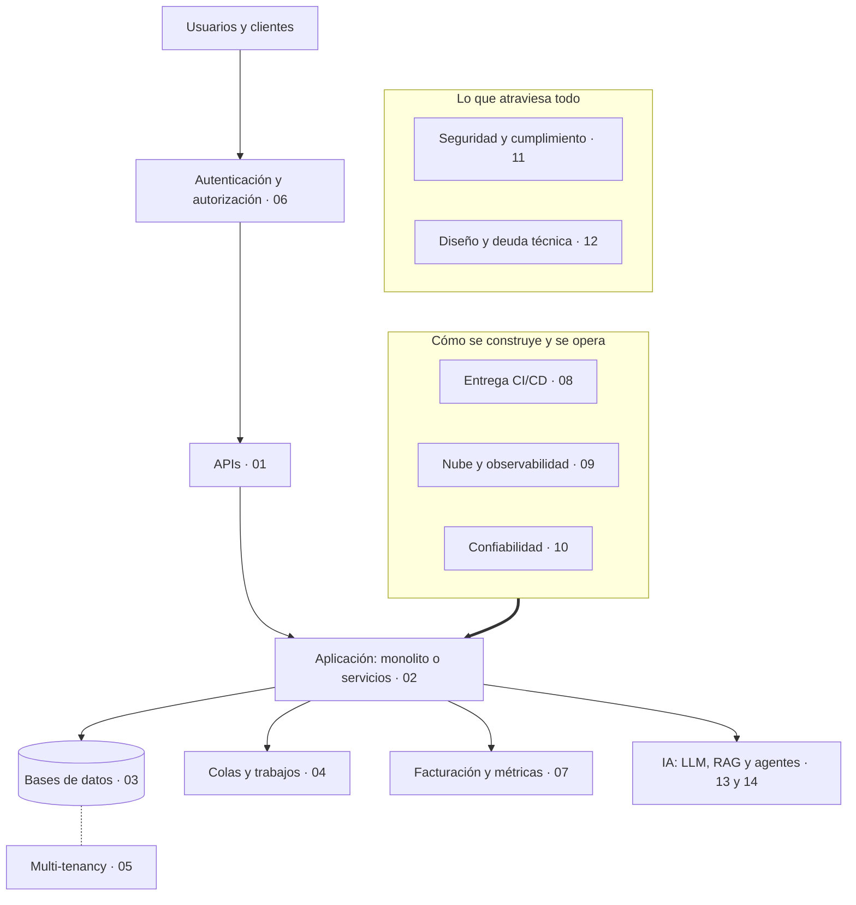

# SaaS para Scrum Masters

## Idea clave

No necesitas programar para conversar de igual a igual con tu equipo técnico. Necesitas un **mapa**: saber qué piezas tiene un producto SaaS, cómo se conectan, dónde suelen romperse y qué preguntas abren la conversación correcta. Esta guía te da ese mapa, módulo por módulo, pensado para que detectes riesgos temprano y ayudes a priorizar deuda técnica frente a funcionalidades con argumentos, no con intuición.

Un SaaS (*Software as a Service*) es software que el cliente no instala: lo usa a través de internet, paga una suscripción y comparte la misma plataforma con otros clientes. Esa última frase esconde casi todos los desafíos técnicos que verás aquí: muchos clientes a la vez (multi-tenancy), cobro recurrente (facturación), disponibilidad constante (confiabilidad) y confianza (seguridad y cumplimiento).

## Mapa general

Lee el diagrama de arriba hacia abajo como el viaje de una petición: alguien inicia sesión, llama a una API, la aplicación hace su trabajo, guarda datos, deja tareas pendientes en una cola, puede apoyarse en modelos de IA y, si corresponde, registra algo que se cobra. Al costado está la plataforma que permite cambiar todo eso con seguridad, y alrededor, dos temas que tocan cada decisión: seguridad y diseño.

## Lo que debes entender

### Cómo está organizado cada módulo

| Sección | Para qué te sirve |
|---|---|
| Idea clave | El concepto en un párrafo. Si solo lees esto, ya puedes seguir una conversación. |
| Diagramas | La forma del sistema. Úsalos en refinamientos o en una pizarra. |
| Lo que debes entender | Vocabulario, comparaciones y criterios para opinar. |
| Preguntas para tu equipo | Preguntas abiertas que puedes llevar a una daily, refinamiento o retro. |
| Errores comunes | Señales de riesgo que conviene detectar temprano. |
| Tu rol como Scrum Master | Cómo traducir lo aprendido en facilitación y decisiones de producto. |

### Prioridad de estudio

No todos los módulos pesan igual para tu trabajo diario. Esta es una sugerencia; ajústala a lo que más se discute en tu equipo.

| Prioridad | Módulos | Por qué primero |
|---|---|---|
| Alta | 01 APIs, 08 Entrega CI/CD, 10 Confiabilidad, 12 Deuda técnica | Aparecen en casi todos los sprints y afectan directamente el flujo de trabajo. |
| Media | 02 Arquitectura, 03 Bases de datos, 05 Multi-tenancy, 06 Autenticación, 09 Observabilidad | Explican por qué ciertas historias son más caras o riesgosas de lo que parecen. |
| Alta si tu producto usa IA | 13 IA: fundamentos, 14 IA: RAG y agentes | La IA cambia cómo se estima, se prueba y se define "hecho"; y tu equipo probablemente ya la usa para programar. |
| Contexto | 04 Colas, 07 Facturación, 11 Seguridad y cumplimiento | Muy importantes, pero suelen tener dueños especializados; necesitas entender el lenguaje y los riesgos. |
| Práctica | 15 Plan y glosario | Úsalo como ruta de 30 días y como consulta rápida. |

### Cómo usar esta guía

- Marca cada módulo como completado en la barra lateral: el progreso queda guardado en este navegador.
- ¿Prefieres escuchar? Usa el botón **Escuchar este módulo**: el navegador lee el texto en voz alta con las voces de tu dispositivo, también en iPhone.
- Lleva **una** pregunta por semana a tu equipo. Es mejor una conversación honesta que diez preguntas de checklist.
- Cuando no entiendas algo en una reunión, anótalo y búscalo aquí o en el [glosario](15-plan-y-glosario.md).

## Preguntas para tu equipo

1. Si tuvieran que dibujar nuestro sistema en cinco cajas, ¿cuáles serían?
2. ¿Qué parte del sistema les da más miedo tocar, y por qué?
3. ¿Qué tema técnico creen que el negocio no entiende y les gustaría que yo ayudara a explicar?
4. ¿Qué información técnica les sería útil que apareciera en el refinamiento y hoy no aparece?

## Errores comunes

- **Querer aprenderlo todo antes de preguntar.** El equipo valora más la curiosidad genuina que la precisión técnica.
- **Usar el vocabulario para opinar sobre soluciones.** Tu objetivo es entender riesgos y costos, no decidir la arquitectura.
- **Tratar la deuda técnica como "pedido del equipo" en vez de como riesgo de negocio.** Esta guía te ayuda a traducirla.

> **Tu rol como Scrum Master**
>
> No eres el arquitecto ni el líder técnico. Eres quien hace visible lo invisible: riesgos que nadie nombró, dependencias que bloquean, deuda que encarece cada historia. Entender la técnica te permite hacer mejores preguntas y facilitar decisiones informadas entre el equipo y el Product Owner.
