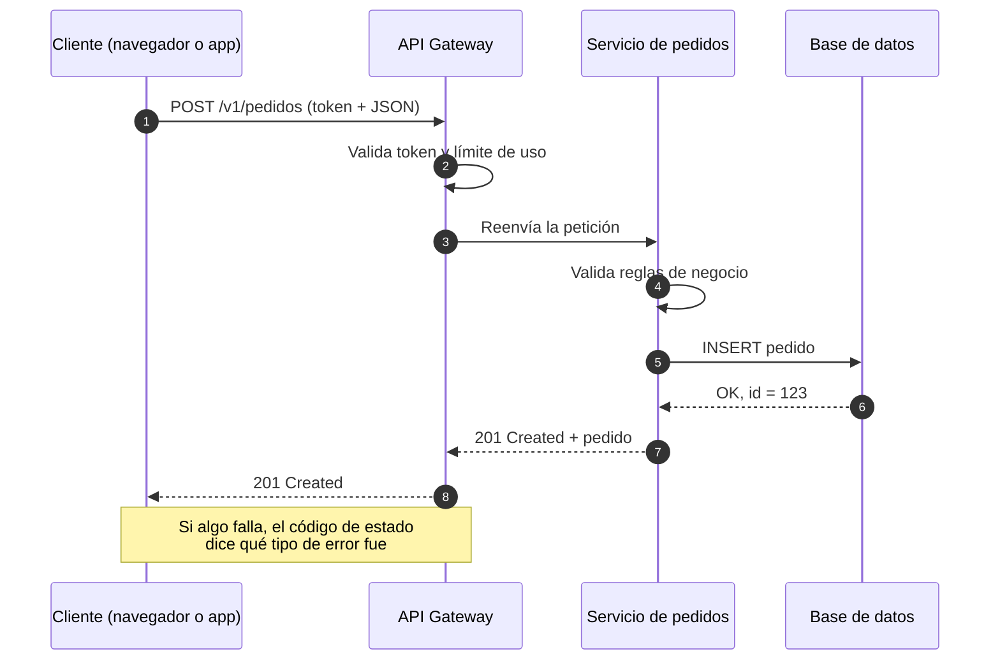
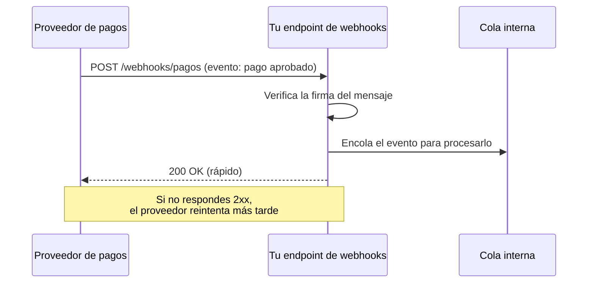

# APIs: cómo conversan los sistemas

## Idea clave

Una API (*Application Programming Interface*) es un **contrato**: define qué se puede pedir a un sistema, con qué formato y qué responderá. En un SaaS, casi todo pasa por APIs: el frontend habla con el backend, el backend con servicios internos y con terceros (pagos, correo, mapas), y muchos clientes integran sus propios sistemas con el tuyo. Cambiar un contrato sin cuidado rompe a quien depende de él, a veces sin que te enteres.

## Diagramas

### Una petición cliente-servidor

### Webhooks: cuando el otro sistema te avisa

## Lo que debes entender

### Anatomía de una petición HTTP

- **Método**: la intención. `GET` lee, `POST` crea, `PUT`/`PATCH` actualizan, `DELETE` borra.
- **URL o ruta**: el recurso, por ejemplo `/v1/clientes/42/facturas`.
- **Cabeceras**: metadatos, como el token de autenticación o el formato del contenido.
- **Cuerpo**: los datos, casi siempre en JSON.
- **Código de estado**: la respuesta resumida en un número.

| Familia | Significado | Ejemplos que oirás |
|---|---|---|
| 2xx | Éxito | 200 OK, 201 Created, 204 No Content |
| 3xx | Redirección | 301 Moved Permanently, 304 Not Modified |
| 4xx | Error del cliente: la petición está mal | 400 Bad Request, 401 Unauthorized, 403 Forbidden, 404 Not Found, 409 Conflict, 429 Too Many Requests |
| 5xx | Error del servidor: falló tu sistema | 500 Internal Server Error, 502 Bad Gateway, 503 Service Unavailable, 504 Gateway Timeout |

Un aumento de 4xx suele indicar un problema en quien llama (o un cambio de contrato que lo rompió). Un aumento de 5xx casi siempre es un problema tuyo.

### Estilos de API

| Estilo | Cómo funciona | Fortalezas | Cuidados |
|---|---|---|---|
| REST | Recursos con URLs y métodos HTTP | Simple, universal, fácil de cachear | Puede requerir muchas llamadas para armar una pantalla |
| GraphQL | Un endpoint; el cliente pide exactamente los campos que necesita | Flexible para frontends con pantallas variadas | Consultas costosas difíciles de limitar; caché más compleja |
| gRPC | Contratos tipados y binarios entre servicios | Rápido y eficiente para tráfico interno | Menos práctico para navegadores y clientes externos |
| Webhooks | Tu sistema recibe (o envía) avisos cuando ocurre un evento | Evita consultar una y otra vez | Hay que verificar firmas, tolerar duplicados y reintentos |

### Conceptos que aparecen en refinamientos

- **Versionado**: `/v1/` y `/v2/` permiten cambiar el contrato sin romper a los clientes actuales. Un cambio *breaking* (quitar un campo, cambiar un tipo) exige nueva versión o un plan de migración.
- **Idempotencia**: repetir la misma petición produce el mismo resultado. Es clave para pagos: si la red falla y el cliente reintenta, no debe cobrarse dos veces. Se suele implementar con una *idempotency key*.
- **Rate limiting**: límite de peticiones por cliente en un periodo. Protege la plataforma y suele ser parte del plan comercial.
- **Paginación**: devolver resultados por páginas en lugar de miles de registros de una vez.
- **Timeouts y reintentos**: toda llamada externa puede tardar o fallar. Sin límite de tiempo, un proveedor lento puede bloquear tu sistema completo.
- **Documentación del contrato**: especificaciones como OpenAPI describen la API de forma legible por personas y por herramientas.

## Preguntas para tu equipo

1. ¿Quién consume esta API? ¿Solo nuestro frontend o también clientes e integradores externos?
2. ¿Este cambio rompe el contrato actual? Si es así, ¿cómo y cuándo avisamos a quienes lo usan?
3. ¿Qué pasa si el proveedor externo tarda 30 segundos en responder o no responde?
4. ¿Esta operación es segura de reintentar? ¿Podría duplicar un cobro, un correo o un registro?
5. ¿Cómo sabremos en producción que esta API está fallando antes de que un cliente nos avise?

## Errores comunes

- **Estimar una integración con un tercero como si fuera una funcionalidad interna.** Las integraciones traen documentación incompleta, entornos de prueba limitados y comportamientos inesperados.
- **Cambiar respuestas de la API "porque solo la usa el frontend"** y descubrir que un cliente la integró por su cuenta.
- **No definir timeouts**, de modo que un tercero lento termina tumbando tu servicio.
- **Procesar webhooks dentro de la misma petición**: si el procesamiento tarda, el proveedor reintenta y llegan duplicados.

> **Tu rol como Scrum Master**
>
> Cuando una historia diga "integrar con X", ayuda a separar el descubrimiento (probar la API, leer límites, revisar el entorno de pruebas) de la implementación. Un *spike* corto antes de comprometer la historia reduce sorpresas y protege la previsibilidad del sprint.
