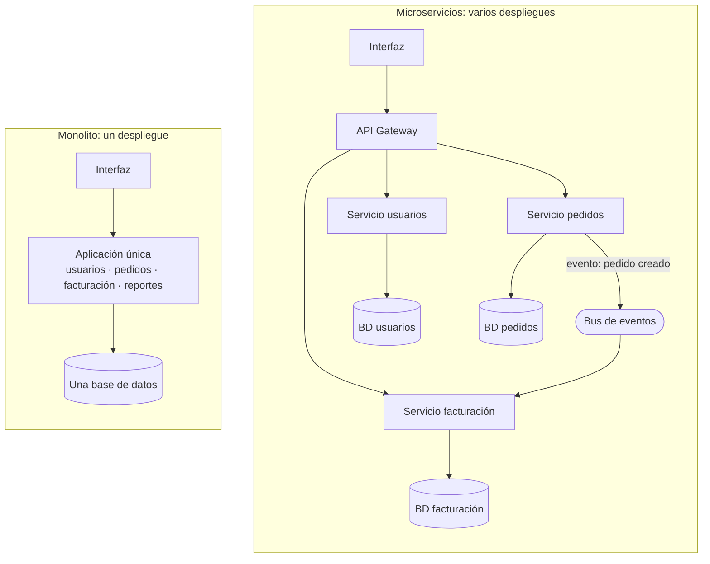
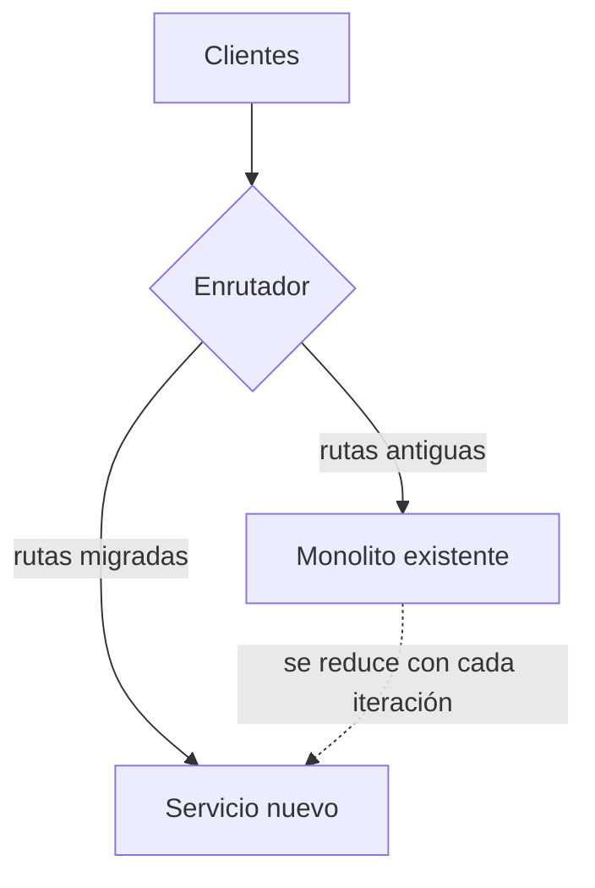

# Monolito y microservicios

## Idea clave

La arquitectura es la forma en que se reparte el código y las responsabilidades. Un **monolito** es una sola aplicación que se despliega completa; los **microservicios** son varias aplicaciones pequeñas que se despliegan por separado y se comunican por red. Ninguna es "la moderna" ni "la correcta": cada una cambia qué es fácil y qué es difícil. La pregunta útil no es "¿monolito o microservicios?", sino "¿qué problema concreto estamos intentando resolver?".

## Diagramas

### Monolito frente a microservicios

### Migración gradual: el patrón *strangler fig*

En lugar de reescribir todo de una vez, se extraen funcionalidades una a una detrás de un enrutador, hasta que el sistema antiguo queda vacío o pequeño.

## Lo que debes entender

### Comparación honesta

| Dimensión | Monolito | Microservicios |
|---|---|---|
| Inicio del producto | Rápido y simple | Costoso: mucha infraestructura antes de entregar valor |
| Despliegue | Todo junto; un error puede frenar todo | Independiente por servicio |
| Equipos | Fricción cuando muchos equipos tocan el mismo código | Equipos autónomos si los límites están bien definidos |
| Fallos | Un error puede tumbar la aplicación completa | Fallos parciales; hay que diseñar para ellos |
| Datos | Transacciones simples en una base de datos | Consistencia entre servicios mucho más difícil |
| Observabilidad | Un log, un proceso | Necesitas trazas distribuidas para seguir una petición |
| Costo operativo | Bajo | Alto: más pipelines, más monitoreo, más guardias |

### El punto medio: monolito modular

Muchos equipos se benefician de un **monolito modular**: una sola aplicación, pero con módulos internos con límites claros (por ejemplo, facturación no accede directamente a las tablas de pedidos). Da gran parte del orden de los microservicios sin el costo de operar una red de servicios, y facilita extraer un servicio más adelante si de verdad hace falta.

### Señales que sí justifican separar servicios

- Una parte del sistema necesita escalar muy distinto al resto (por ejemplo, procesamiento de archivos).
- Varios equipos se bloquean entre sí constantemente al desplegar.
- Una parte requiere aislamiento por seguridad o cumplimiento.
- Una parte cambia a un ritmo muy distinto o usa una tecnología distinta por buenas razones.

### Ley de Conway

La observación de Melvin Conway dice, en esencia, que los sistemas tienden a reflejar la estructura de comunicación de las organizaciones que los construyen. Si dos equipos casi no hablan, sus servicios tenderán a integrarse mal. Por eso la arquitectura y la organización de los equipos son decisiones que conviene tomar juntas.

## Preguntas para tu equipo

1. ¿Qué problema concreto resolvería separar este servicio? ¿Cómo sabremos que lo resolvió?
2. ¿Qué partes del código cambian juntas casi siempre? ¿Están en el mismo lugar?
3. Si este servicio cae, ¿qué deja de funcionar para el cliente?
4. ¿Cuántos equipos o personas deben coordinarse para desplegar esta historia?
5. ¿Tenemos la observabilidad necesaria para operar un servicio más?

## Errores comunes

- **"Microservicios por currículum"**: adoptarlos por moda y terminar con un *monolito distribuido*, donde todo sigue acoplado pero ahora por red.
- **Reescribir desde cero** en lugar de migrar gradualmente. Las reescrituras completas suelen tardar mucho más de lo previsto y congelan la entrega de valor.
- **Compartir una base de datos entre servicios** "temporalmente", lo que acopla todo de nuevo.
- **Ignorar el costo operativo**: cada servicio nuevo necesita pipeline, monitoreo, alertas, dueño y documentación.

> **Tu rol como Scrum Master**
>
> Si el equipo propone una migración de arquitectura, pide que se exprese como un objetivo de negocio medible (por ejemplo, "desplegar facturación sin coordinar con otros dos equipos") y que se divida en incrementos que entreguen valor. Una migración sin hitos visibles es una de las formas más comunes de perder la confianza del negocio.
