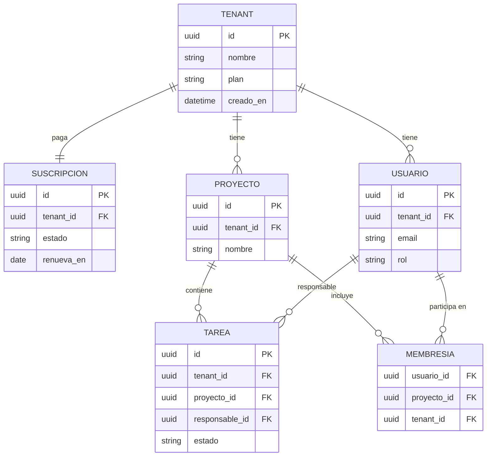
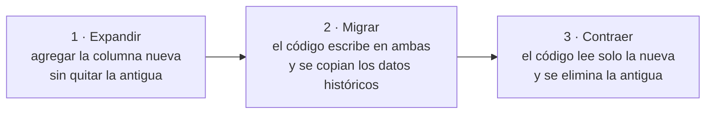

# Bases de datos

## Idea clave

La base de datos es la **memoria** del producto y, casi siempre, la parte más difícil de cambiar. El código se puede reemplazar en un despliegue; los datos de miles de clientes no. Por eso las historias que tocan el modelo de datos (agregar un campo obligatorio, cambiar una relación, migrar millones de registros) merecen más atención que su apariencia sugiere.

## Diagramas

### Modelo de datos típico de un SaaS

Fíjate en que casi todas las tablas llevan `tenant_id`: identifica a qué cliente pertenece cada registro. Olvidar filtrar por esa columna en una sola consulta puede mostrar datos de un cliente a otro (más en el [módulo 05](05-multi-tenancy.md)).

### Migración segura en tres pasos: *expand and contract*

Cada paso es un despliegue separado y reversible. Es más lento que un cambio único, pero evita caídas y permite volver atrás.

## Lo que debes entender

### Relacionales y no relacionales

| Tipo | Ejemplos | Bueno para | Cuidados |
|---|---|---|---|
| Relacional (SQL) | PostgreSQL, MySQL, SQL Server | Datos estructurados, relaciones, transacciones | Cambios de esquema requieren migraciones planificadas |
| Documentos | MongoDB, Firestore | Estructuras flexibles o anidadas | Consistencia y relaciones quedan en manos del código |
| Clave-valor / caché | Redis, Memcached | Lecturas muy rápidas, sesiones, contadores | Normalmente no es la fuente de verdad |
| Búsqueda | Elasticsearch, OpenSearch | Búsqueda de texto y filtros complejos | Es una copia: puede quedar desfasada |
| Analítica | BigQuery, Snowflake, Redshift | Reportes sobre grandes volúmenes | No sirve para la operación diaria del producto |

### Conceptos clave

- **Transacción**: un grupo de operaciones que se aplica completo o no se aplica. Evita estados a medias (por ejemplo, cobrar sin registrar el pedido).
- **ACID**: propiedades que garantizan transacciones confiables (atomicidad, consistencia, aislamiento, durabilidad).
- **Índice**: estructura que acelera búsquedas, como el índice de un libro. Sin índices, una consulta que funciona con 1.000 filas puede volverse lentísima con 10 millones.
- **Migración de esquema**: script versionado que cambia la estructura de la base de datos. Debe estar en el repositorio y pasar por revisión.
- **Réplica de lectura**: copia de la base de datos para repartir consultas de solo lectura. Puede ir unos instantes atrasada.
- **Respaldo (backup)** y **restauración**: un respaldo que nunca se ha probado restaurar no es un respaldo confiable.
- **RPO y RTO**: cuántos datos puedes permitirte perder (*Recovery Point Objective*) y cuánto tiempo puedes estar sin servicio (*Recovery Time Objective*) ante un desastre.

### El problema N+1

Ocurre cuando el código hace una consulta para obtener una lista y luego una consulta adicional por cada elemento. Con 10 elementos pasa inadvertido; con 5.000, la página tarda segundos. Es una de las causas más frecuentes de lentitud que "aparece de repente" cuando crecen los datos de un cliente.

## Preguntas para tu equipo

1. ¿Esta historia cambia el esquema de datos? ¿La migración se puede revertir?
2. ¿Cuánto tarda la migración con el volumen de producción, no con el de desarrollo?
3. ¿Cuándo fue la última vez que probamos restaurar un respaldo? ¿Cuánto tardó?
4. ¿Qué consultas se vuelven lentas con nuestros clientes más grandes?
5. ¿Hay datos personales nuevos en este cambio? ¿Dónde se guardan y quién puede verlos?

## Errores comunes

- **Probar solo con datos pequeños** y descubrir los problemas de rendimiento en producción.
- **Migraciones que bloquean tablas** durante minutos en horario de uso.
- **Agregar un campo obligatorio sin valor por defecto** para los registros existentes.
- **Dar por hecho que hay respaldos** sin haber verificado una restauración.
- **Usar la base de datos de producción para reportes pesados**, degradando la experiencia de los clientes.

> **Tu rol como Scrum Master**
>
> En el refinamiento, pregunta explícitamente "¿esto toca datos existentes?". Si la respuesta es sí, la historia probablemente necesita más de un despliegue (expandir, migrar, contraer) y conviene reflejarlo en la planificación en lugar de descubrirlo a mitad del sprint.
