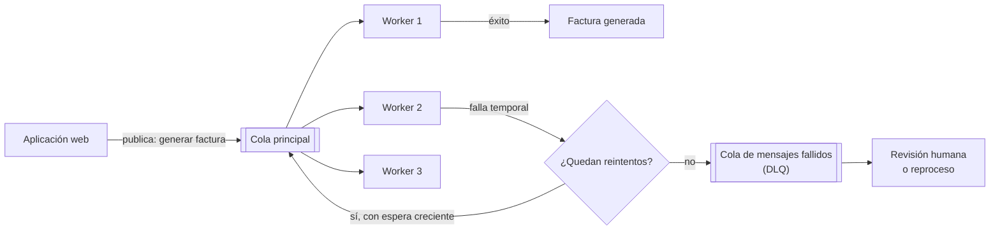
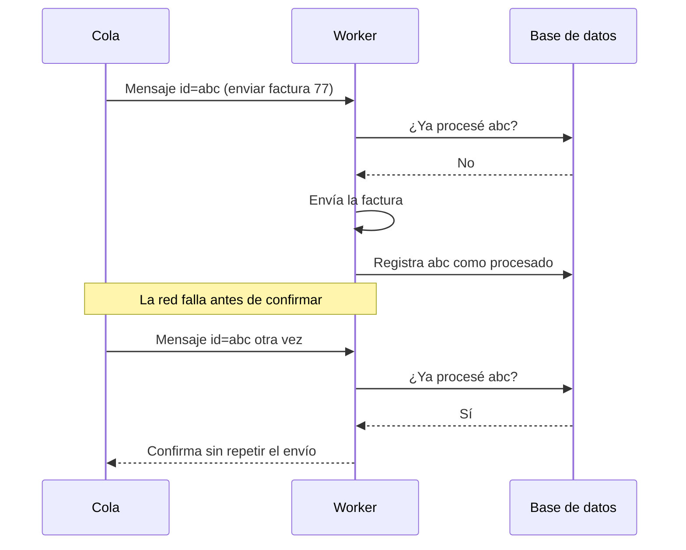

# Colas y asincronía

## Idea clave

No todo debe ocurrir mientras el usuario espera. Enviar correos, generar un PDF, procesar un archivo grande o sincronizar con un tercero son tareas que conviene **dejar anotadas en una cola** para que otros procesos (los *workers*) las ejecuten después. Así la aplicación responde rápido y los picos de trabajo no la tumban. El precio: el sistema se vuelve "eventualmente consistente" y hay que diseñar para reintentos, duplicados y mensajes que nunca logran procesarse.

## Diagramas

### Cola con workers y cola de mensajes fallidos (DLQ)

### Procesamiento idempotente

## Lo que debes entender

### Síncrono frente a asíncrono

| Aspecto | Síncrono | Asíncrono (con cola) |
|---|---|---|
| Experiencia | El usuario espera el resultado | El usuario recibe "lo estamos procesando" |
| Picos de carga | Pueden saturar la aplicación | La cola absorbe el pico y los workers avanzan a su ritmo |
| Fallos de terceros | Se ven de inmediato como error | Se reintentan sin que el usuario lo note |
| Complejidad | Baja | Mayor: estados intermedios, duplicados, orden |
| Depuración | Una sola traza | Hay que seguir el mensaje entre procesos |

### Conceptos clave

- **Productor y consumidor**: quien publica el mensaje y quien lo procesa.
- **Garantías de entrega**: la mayoría de los sistemas garantizan "al menos una vez", lo que significa que **un mensaje puede llegar duplicado**. Por eso el procesamiento debe ser idempotente.
- **Reintentos con *backoff* exponencial**: esperar cada vez más entre intentos para no castigar a un servicio que ya está con problemas.
- **DLQ (*dead letter queue*)**: donde terminan los mensajes que fallaron demasiadas veces. Alguien debe revisarla; si nadie la mira, es un cementerio de errores silenciosos.
- **Orden**: muchas colas no garantizan el orden de los mensajes. Si el orden importa (por ejemplo, "crear" antes de "actualizar"), hay que diseñarlo explícitamente.
- **Profundidad de la cola y antigüedad del mensaje más viejo**: las dos métricas que mejor indican si los workers dan abasto.
- **Colas y eventos**: una cola reparte trabajo entre workers; un *bus de eventos* (o *pub/sub*) avisa a varios interesados de que algo ocurrió. Herramientas comunes: RabbitMQ, Amazon SQS, Kafka, Google Pub/Sub.

## Preguntas para tu equipo

1. ¿Qué ve el usuario mientras la tarea está pendiente? ¿Y si falla?
2. ¿Qué pasa si este mensaje se procesa dos veces?
3. ¿Quién revisa la DLQ y con qué frecuencia? ¿Tenemos alerta si crece?
4. ¿Cuánto puede crecer la cola antes de que los clientes lo noten?
5. ¿Importa el orden en que se procesan estos mensajes?

## Errores comunes

- **Suponer que cada mensaje llega exactamente una vez** y terminar enviando correos o cobros duplicados.
- **Tener una DLQ sin dueño ni alertas**: los errores se acumulan en silencio durante semanas.
- **Reintentar inmediatamente y sin límite**, agravando la caída de un tercero.
- **No diseñar la experiencia del estado "pendiente"**, de modo que el usuario cree que algo falló y vuelve a intentarlo.

> **Tu rol como Scrum Master**
>
> Cuando una historia incluya trabajo en segundo plano, asegúrate de que los criterios de aceptación cubran tres caminos: el éxito, el fallo temporal (reintento) y el fallo definitivo (qué ve el usuario y quién se entera). Ese tercer camino es el que suele quedar fuera y el que más soporte genera después.
