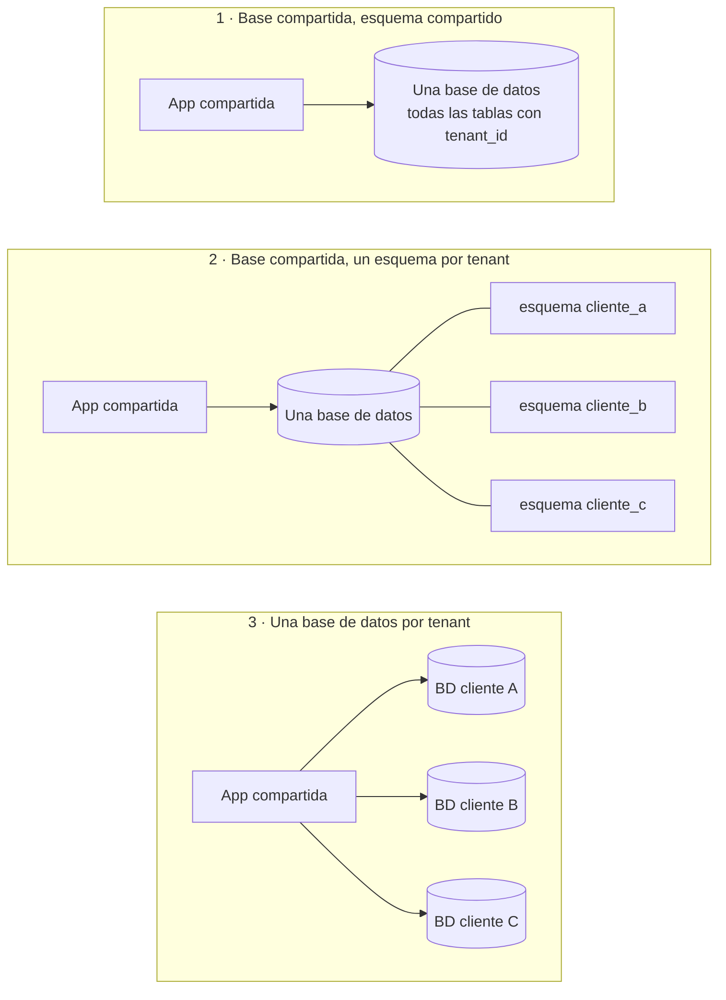

# Multi-tenancy

## Idea clave

Un *tenant* (inquilino) es un cliente de tu SaaS: una empresa, un colegio, una clínica. **Multi-tenancy** significa que muchos tenants usan la misma plataforma al mismo tiempo, compartiendo infraestructura pero sin ver los datos de los demás. Es lo que hace que un SaaS sea económico de operar, y también la fuente de uno de sus riesgos más graves: que los datos de un cliente se filtren a otro.

## Diagramas

### Tres modelos de aislamiento

## Lo que debes entender

### Comparación de modelos

| Criterio | 1 · Esquema compartido | 2 · Esquema por tenant | 3 · BD por tenant |
|---|---|---|---|
| Costo por cliente | El más bajo | Medio | El más alto |
| Aislamiento de datos | Lógico: depende del código | Mayor separación lógica | Fuerte: separación física |
| Riesgo de fuga entre clientes | El más alto si falta un filtro | Medio | El más bajo |
| Migraciones de esquema | Una sola vez | Una por esquema | Una por base de datos |
| Clientes grandes que afectan a otros | Más probable | Posible | Poco probable |
| Requisitos de residencia de datos | Difícil de cumplir por cliente | Difícil | Más sencillo |
| Típico para | Muchos clientes pequeños (autoservicio) | Escala media | Clientes empresariales o regulados |

Muchos productos combinan modelos: esquema compartido para la mayoría y bases dedicadas para clientes empresariales que lo pagan o lo exigen por contrato.

### Riesgos propios del multi-tenancy

- **Fuga de datos entre tenants**: una consulta sin `WHERE tenant_id = ...`, una caché compartida con una clave mal armada o un archivo guardado sin separar por cliente. Mitigaciones habituales: filtros automáticos en la capa de acceso a datos, seguridad a nivel de fila (*row-level security*) en la base de datos y pruebas automáticas que intentan acceder a datos de otro tenant.
- **Vecino ruidoso (*noisy neighbor*)**: un cliente grande ejecuta una importación masiva y degrada el servicio para todos. Mitigaciones: límites de uso por tenant, colas separadas, recursos dedicados para clientes grandes.
- **Personalización excesiva**: cada cliente pide "su" variante y el producto se convierte en muchos productos. Las configuraciones y los *feature flags* por tenant ayudan, pero tienen un costo de mantenimiento.
- **Operaciones por tenant**: exportar, restaurar o borrar los datos de un solo cliente (por ejemplo, cuando se va o lo pide la ley) debe ser posible y estar probado.

### El ciclo de vida de un tenant

Alta (*onboarding*), configuración, uso, cambio de plan, suspensión por impago, baja y eliminación de datos. Cada etapa tiene implicaciones técnicas y legales; conviene que el equipo sepa cuáles están automatizadas y cuáles son manuales.

## Preguntas para tu equipo

1. ¿Qué modelo de aislamiento usamos? ¿Es el mismo para todos los clientes?
2. ¿Qué mecanismo impide que una consulta nueva olvide filtrar por tenant? ¿Hay pruebas que lo verifiquen?
3. ¿Qué pasa con el resto de los clientes si nuestro cliente más grande duplica su uso mañana?
4. ¿Podemos exportar o borrar todos los datos de un solo cliente? ¿Cuánto tarda?
5. ¿Las cachés, archivos y logs también están separados por tenant?

## Errores comunes

- **Confiar en que "todos recuerdan" agregar el filtro de tenant** en cada consulta.
- **Probar siempre con un único tenant** en desarrollo, donde la fuga es imposible de ver.
- **Aceptar personalizaciones por cliente sin costo visible** en el backlog.
- **No medir el uso por tenant**, de modo que no se sabe quién consume los recursos ni si el precio cubre el costo.

> **Tu rol como Scrum Master**
>
> Propón que "un usuario de otro tenant no puede ver ni modificar estos datos" sea parte de la Definición de Hecho para toda historia que exponga datos. Es una línea en un checklist que previene el tipo de incidente que más daña la confianza de un cliente.
