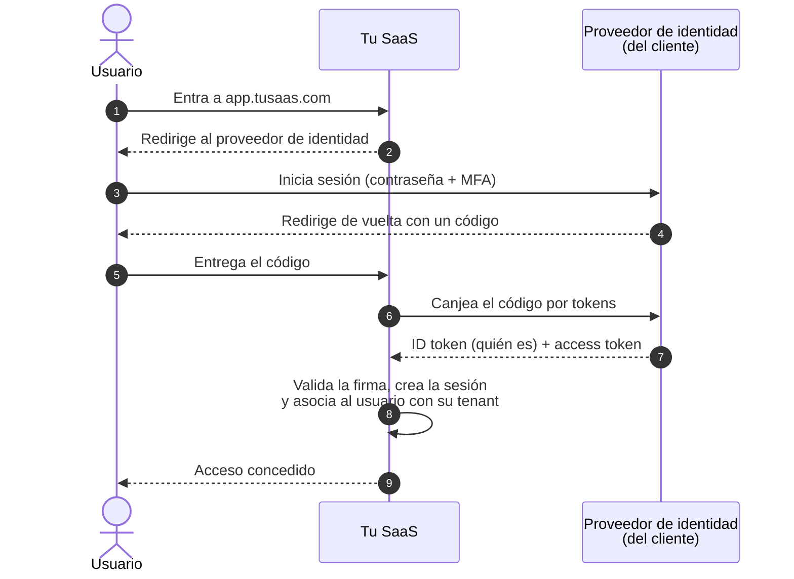
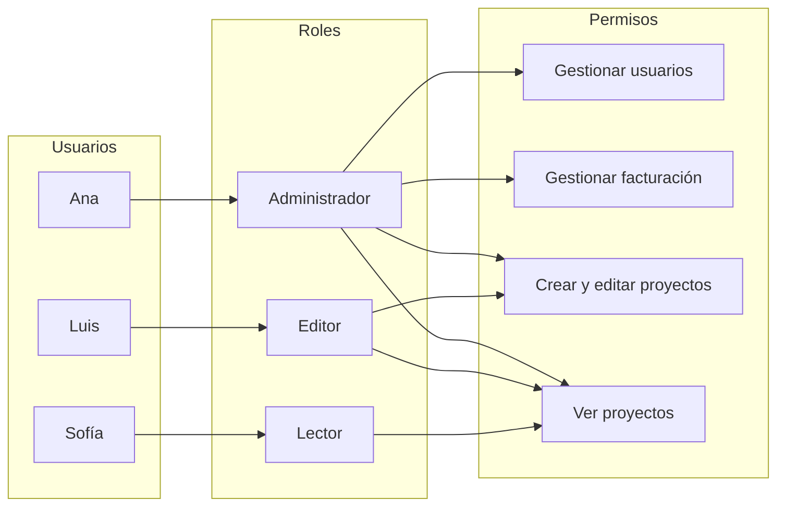

# Autenticación y autorización

## Idea clave

Son dos preguntas distintas que se confunden a menudo. **Autenticación** responde "¿quién eres?" (iniciar sesión). **Autorización** responde "¿qué puedes hacer?" (permisos). Un sistema puede saber perfectamente quién eres y aun así dejarte ver algo que no deberías: ese error de autorización es una de las vulnerabilidades más frecuentes en aplicaciones web. En SaaS para empresas, además, los clientes esperan iniciar sesión con su propio proveedor de identidad (SSO).

## Diagramas

### Inicio de sesión con SSO usando OpenID Connect

### Control de acceso basado en roles (RBAC)

Los permisos se asignan a roles y los roles a personas. Así, cuando alguien cambia de puesto, se le cambia el rol y no hay que revisar decenas de permisos sueltos.

## Lo que debes entender

### Autenticación: piezas y siglas

| Concepto | Qué es |
|---|---|
| MFA | Autenticación multifactor: algo que sabes (contraseña) más algo que tienes (app, llave física) o eres (biometría). |
| SSO | *Single Sign-On*: un solo inicio de sesión para muchas aplicaciones, gestionado por el proveedor de identidad de la empresa. |
| Proveedor de identidad (IdP) | Sistema que gestiona las cuentas de una organización, por ejemplo Microsoft Entra ID, Okta o Google Workspace. |
| OAuth 2.0 | Estándar para **delegar acceso**: permitir que una aplicación actúe en tu nombre sin darle tu contraseña. |
| OpenID Connect (OIDC) | Capa sobre OAuth 2.0 que agrega **identidad**: quién es el usuario. Es la base de la mayoría de los SSO modernos. |
| SAML | Estándar más antiguo de SSO, basado en XML, todavía muy común en grandes empresas. |
| SCIM | Estándar para **aprovisionar** usuarios: cuando la empresa da de alta o de baja a alguien, se refleja automáticamente en tu SaaS. |
| JWT | Formato de token firmado que transporta datos (*claims*) del usuario. Que esté firmado no significa que esté cifrado. |
| Passkeys | Credenciales basadas en criptografía de clave pública que reemplazan la contraseña y resisten mejor el *phishing*. |

### Autorización: modelos

| Modelo | Cómo decide | Ventaja | Limitación |
|---|---|---|---|
| RBAC | Según el rol del usuario | Simple de entender y auditar | Explosión de roles si se usa para todo |
| ABAC | Según atributos (área, región, horario, nivel del dato) | Muy expresivo | Más difícil de razonar y probar |
| ReBAC | Según relaciones ("es miembro de este proyecto") | Natural para colaboración y documentos compartidos | Requiere infraestructura específica |

### Principios a recordar

- **Mínimo privilegio**: cada persona y cada sistema con los permisos justos para su tarea.
- **Verificar en el servidor, siempre**: ocultar un botón en la interfaz no es seguridad.
- **El tenant también es un permiso**: cada verificación debe confirmar que el recurso pertenece al tenant del usuario.
- **Revocación**: cuando alguien deja la empresa cliente, su acceso debe cerrarse rápido (aquí ayuda SCIM).

## Preguntas para tu equipo

1. ¿Dónde se verifica que este usuario puede hacer esta acción sobre este recurso específico?
2. ¿Qué pasa si alguien cambia el ID en la URL por el de un recurso de otro cliente?
3. ¿Cuánto tarda en perder el acceso un usuario dado de baja en el proveedor de identidad del cliente?
4. ¿Ofrecemos SSO y MFA? ¿En qué planes? ¿Lo están pidiendo los clientes empresariales?
5. ¿Tenemos registro de auditoría de quién cambió permisos y cuándo?

## Errores comunes

- **Confundir autenticación con autorización** y dar por segura una pantalla solo porque exige iniciar sesión.
- **Verificar permisos solo en el frontend.**
- **Construir un sistema de login propio** en lugar de usar estándares y proveedores probados.
- **Crear un rol nuevo para cada cliente** hasta que nadie entiende quién puede hacer qué.
- **Subestimar el SSO empresarial**: cada proveedor de identidad tiene particularidades y la configuración con cada cliente requiere soporte.

> **Tu rol como Scrum Master**
>
> En cada historia que agregue una acción nueva, ayuda a que el equipo y el Product Owner respondan explícitamente "¿quién puede hacer esto?". Si la respuesta es "depende", hay una conversación de producto pendiente que conviene tener antes del sprint, no durante.
