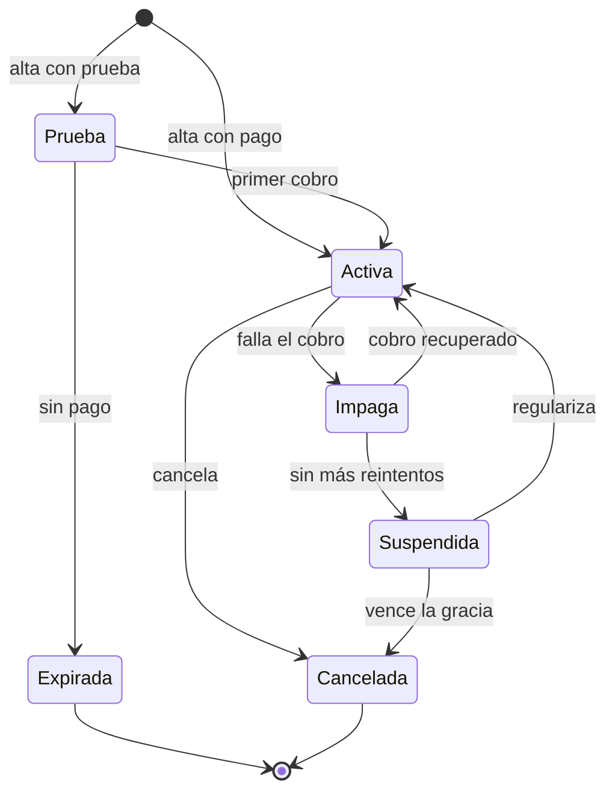
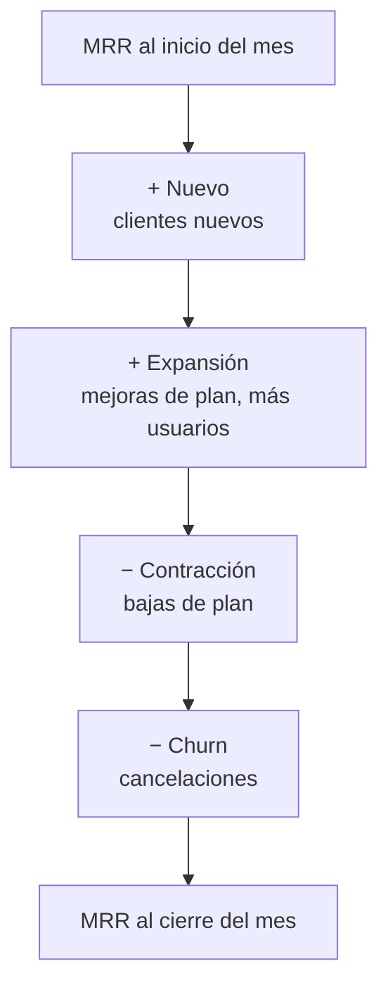

# Facturación y métricas SaaS

## Idea clave

En un SaaS, el cliente no compra una vez: **renueva** cada mes o cada año. Por eso la facturación no es "un botón de pagar", sino un sistema con estados (prueba, activa, impaga, cancelada), cambios de plan a mitad de ciclo, impuestos, reintentos de cobro y conciliación con un proveedor de pagos. Y las métricas del negocio (MRR, churn, retención) salen de esos mismos datos: si la facturación está mal modelada, las decisiones de producto se toman sobre números equivocados.

## Diagramas

### Estados de una suscripción

Cada renovación cobrada mantiene la suscripción en "Activa". Cada transición suele disparar algo: correos, cambios de acceso, eventos para las métricas. Las preguntas difíciles están en los bordes: ¿qué puede hacer un cliente "Impago"? ¿Cuánto tiempo conservamos los datos de uno "Cancelado"?

### De dónde sale el MRR del mes

## Lo que debes entender

### Modelos de precio

| Modelo | Cómo se cobra | Implicancia técnica |
|---|---|---|
| Tarifa plana | Un precio fijo por plan | Simple; el desafío está en qué incluye cada plan |
| Por usuario (*per seat*) | Según la cantidad de usuarios | Hay que contar usuarios activos y prorratear altas a mitad de ciclo |
| Por uso | Según consumo: llamadas a la API, GB, transacciones | Requiere medir el uso de forma confiable y auditable |
| Escalonado (*tiered*) | Precio distinto según tramos de uso | Lógica de cálculo más compleja y propensa a errores |
| Híbrido | Base fija más uso | Combina las dificultades de ambos |
| Freemium | Plan gratuito con límites | Hay que aplicar límites (*entitlements*) en el producto |

### Conceptos de facturación

- **Proveedor de pagos**: Stripe, Adyen, Mercado Pago, PayPal y otros procesan tarjetas y, a menudo, gestionan suscripciones. Rara vez conviene construir esto desde cero.
- **Prorrateo**: si un cliente sube de plan a mitad de mes, ¿cuánto se le cobra? Cada producto debe decidirlo y explicarlo.
- ***Dunning***: el proceso de reintentar cobros fallidos y avisar al cliente. Un buen *dunning* recupera ingresos que de otro modo se perderían por tarjetas vencidas.
- ***Entitlements***: qué funcionalidades y límites tiene cada plan. Conviene que estén en datos o configuración, no repartidos como `if plan == "pro"` por todo el código.
- **Impuestos y documentos tributarios**: dependen del país (IVA, facturación electrónica). Suelen requerir integración con servicios locales.
- **Conciliación**: comprobar que lo que dice tu sistema coincide con lo que dice el proveedor de pagos y con contabilidad.

### Métricas SaaS esenciales

| Métrica | Qué mide | Cómo se calcula (simplificado) |
|---|---|---|
| MRR | Ingreso recurrente mensual | Suma del valor mensual de todas las suscripciones activas |
| ARR | Ingreso recurrente anual | MRR × 12 (como referencia de escala) |
| Churn de clientes (*logo churn*) | Qué proporción de clientes se va | Clientes perdidos en el periodo ÷ clientes al inicio |
| Churn de ingresos | Qué proporción del MRR se pierde | (Contracción + churn) ÷ MRR al inicio |
| NRR (retención neta de ingresos) | Si los clientes existentes crecen o decrecen | (MRR inicial + expansión − contracción − churn) ÷ MRR inicial |
| GRR (retención bruta de ingresos) | Cuánto se conserva sin contar expansión | (MRR inicial − contracción − churn) ÷ MRR inicial |
| ARPA | Ingreso promedio por cuenta | MRR ÷ número de clientes |
| CAC | Costo de adquirir un cliente | Gasto de ventas y marketing ÷ clientes nuevos |
| LTV | Valor de vida estimado de un cliente | Varias fórmulas; una común es ARPA × margen bruto ÷ churn |

**Ejemplo ilustrativo** (números inventados para practicar el cálculo): MRR inicial 100.000; nuevo 8.000; expansión 5.000; contracción 2.000; churn 4.000.

- MRR final = 100.000 + 8.000 + 5.000 − 2.000 − 4.000 = **107.000**
- NRR = (100.000 + 5.000 − 2.000 − 4.000) ÷ 100.000 = **99 %**
- GRR = (100.000 − 2.000 − 4.000) ÷ 100.000 = **94 %**

Un NRR superior a 100 % significa que los clientes existentes, en conjunto, gastan más que antes aunque algunos se vayan. Las definiciones exactas varían entre empresas; lo importante es que el equipo use **una** definición documentada.

## Preguntas para tu equipo

1. ¿Qué pasa con el acceso de un cliente cuando su pago falla? ¿Está definido para cada estado?
2. ¿Dónde se definen los límites de cada plan? ¿Cambiar un plan requiere desplegar código?
3. ¿Cómo verificamos que lo que cobramos coincide con lo que el cliente usó?
4. Si el proveedor de pagos envía el mismo evento dos veces, ¿qué ocurre?
5. ¿De dónde salen las métricas que ve la dirección? ¿Quién valida que el cálculo es correcto?

## Errores comunes

- **Modelar solo el camino feliz** (alta y pago) y dejar sin definir impagos, reembolsos y cambios de plan.
- **Repartir la lógica de planes por todo el código**, lo que hace que lanzar un plan nuevo tarde semanas.
- **Calcular métricas desde distintas fuentes** y tener tres números de MRR distintos en la misma reunión.
- **Probar cobros solo en el entorno de pruebas del proveedor** sin cubrir tarjetas rechazadas, 3-D Secure o monedas distintas.

> **Tu rol como Scrum Master**
>
> Las historias de facturación tienen un costo de error alto y visible para el cliente. Ayuda a que el Product Owner escriba los criterios de aceptación como una tabla de casos (estado actual, evento, resultado esperado) y a que el equipo los use como pruebas. Es un formato que negocio y tecnología pueden leer por igual.
