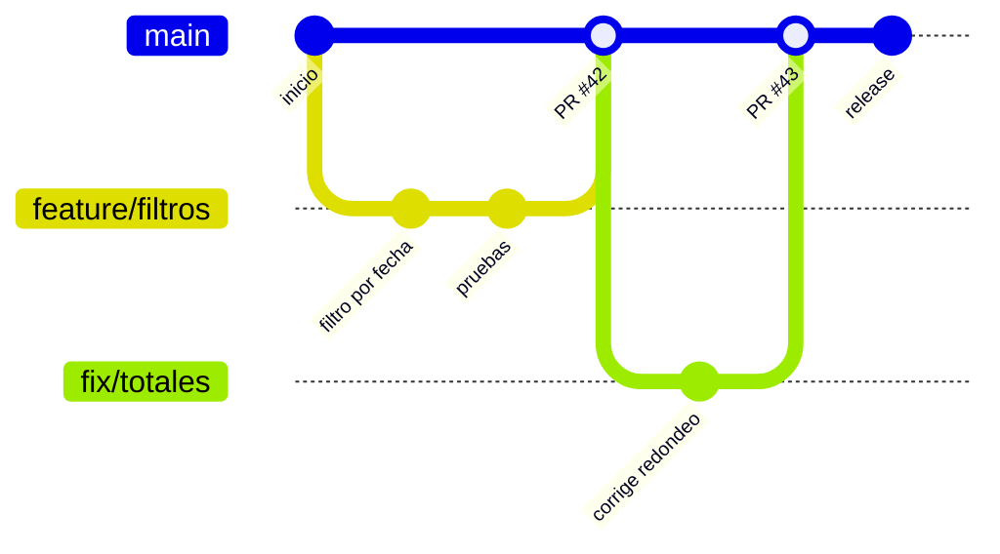
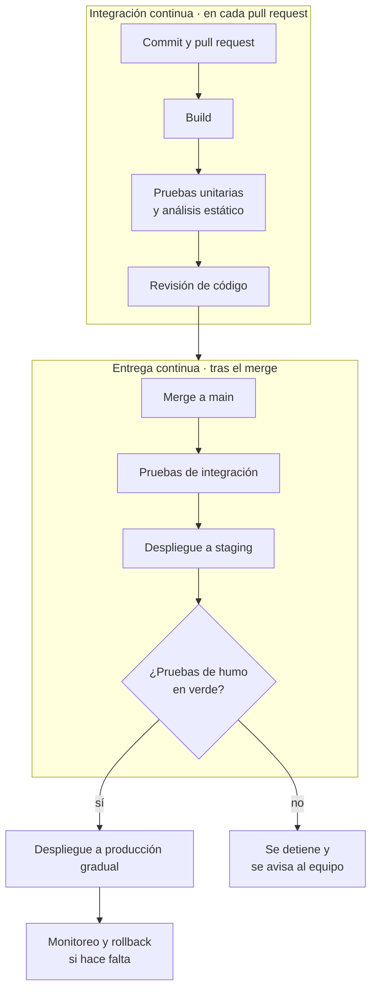
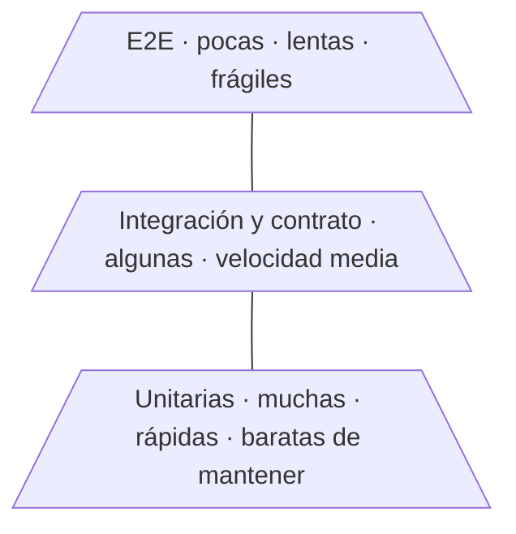
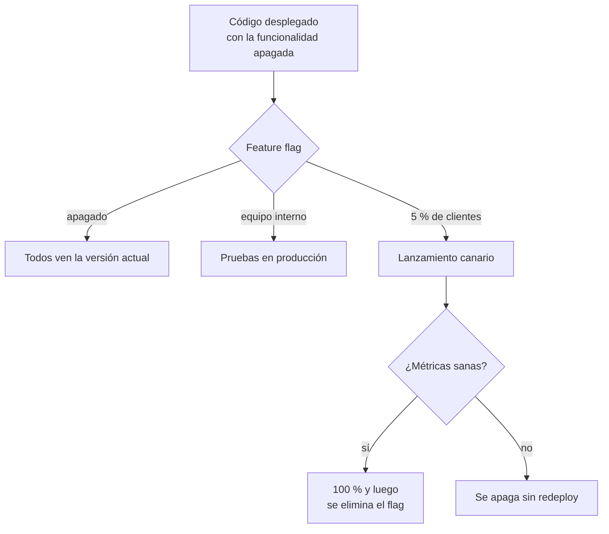

# Entrega: Git, CI/CD, testing y feature flags

## Idea clave

La capacidad de entregar cambios **pequeños, frecuentes y seguros** es probablemente la práctica técnica que más influye en la agilidad real de un equipo. Git guarda la historia del código; la integración continua (CI) verifica cada cambio automáticamente; la entrega o despliegue continuo (CD) lo lleva a producción de forma repetible; las pruebas automáticas dan confianza; y los *feature flags* separan "desplegar" de "lanzar". Juntas, permiten que el sprint termine con valor en manos del cliente y no en una rama esperando.

## Diagramas

### Ramas cortas sobre la rama principal

### Pipeline de CI/CD

### Pirámide de pruebas

La idea: muchas pruebas pequeñas y rápidas en la base, menos pruebas grandes y lentas en la cima. Una "pirámide invertida" (casi todo probado de punta a punta) produce pipelines lentos y resultados poco confiables.

### Desplegar no es lanzar: *feature flags*

## Lo que debes entender

### Git en lo esencial

- **Repositorio, commit, rama, merge**: el repositorio guarda la historia; cada commit es un cambio con descripción; una rama es una línea de trabajo paralela; *merge* la integra de vuelta.
- **Pull request (PR) o merge request**: propuesta de cambio que otra persona revisa antes de integrarla.
- **Trunk-based development**: ramas que viven horas o pocos días y se integran a menudo a la principal. Reduce conflictos y "infiernos de merge".
- **GitFlow**: modelo con ramas de larga vida (develop, release, hotfix). Útil en algunos contextos, pero tiende a retrasar la integración.

### Integración, entrega y despliegue continuo

| Práctica | Qué significa | Lo que exige |
|---|---|---|
| Integración continua (CI) | Cada cambio se integra a la rama principal con frecuencia y se verifica automáticamente | Pruebas automáticas rápidas y confiables |
| Entrega continua | Cada cambio que pasa el pipeline **puede** ir a producción con un clic | Despliegues automatizados y repetibles |
| Despliegue continuo | Cada cambio que pasa el pipeline **va** a producción automáticamente | Alta confianza en pruebas, monitoreo y rollback |

### Estrategias de despliegue

| Estrategia | Cómo funciona | Ventaja |
|---|---|---|
| *Rolling* | Se reemplazan instancias de a poco | Simple, sin infraestructura extra |
| *Blue-green* | Dos entornos idénticos; se cambia el tráfico de uno a otro | Rollback casi instantáneo |
| Canario | Una fracción pequeña del tráfico recibe la versión nueva primero | Detecta problemas con impacto limitado |
| *Feature flags* | El código está desplegado pero la funcionalidad se enciende por configuración | Separa la decisión técnica de la de negocio |

### Tipos de pruebas

| Tipo | Qué verifica | Quién la suele escribir |
|---|---|---|
| Unitaria | Una función o clase aislada | Quien escribe el código |
| Integración | Que varias piezas funcionan juntas (por ejemplo, código y base de datos) | El equipo de desarrollo |
| Contrato | Que una API cumple lo que sus consumidores esperan | Equipos proveedor y consumidor |
| End-to-end (E2E) | Un flujo completo como lo haría un usuario | Desarrollo y QA |
| Humo (*smoke*) | Que lo esencial funciona tras un despliegue | Automatizada en el pipeline |
| Carga o rendimiento | Comportamiento bajo mucho tráfico | Especialistas o el equipo, antes de eventos clave |

La **cobertura de código** indica qué porcentaje del código ejecutan las pruebas, no si las pruebas verifican algo útil. Úsala como señal, no como meta.

### Métricas DORA

El programa de investigación DORA (*DevOps Research and Assessment*) popularizó cuatro métricas para medir el desempeño de entrega de software:

| Métrica | Pregunta que responde | Dimensión |
|---|---|---|
| Frecuencia de despliegue | ¿Con qué frecuencia llegamos a producción? | Velocidad |
| *Lead time* de cambios | ¿Cuánto tarda un commit en llegar a producción? | Velocidad |
| Tasa de fallo de cambios | ¿Qué porcentaje de despliegues causa un problema? | Estabilidad |
| Tiempo de recuperación | ¿Cuánto tardamos en restaurar el servicio tras un fallo? | Estabilidad |

Su hallazgo más útil para conversar con negocio: en sus estudios, velocidad y estabilidad **no** aparecen como fuerzas opuestas; los equipos con mejor desempeño tienden a destacar en ambas. Los informes recientes han ajustado nombres y agregado métricas (por ejemplo, sobre retrabajo); consulta la definición vigente en [dora.dev](https://dora.dev) antes de adoptarlas. Y úsalas para que el equipo mejore, nunca para comparar personas o equipos entre sí.

## Preguntas para tu equipo

1. ¿Cuánto tarda hoy un cambio pequeño desde el commit hasta producción? ¿Dónde espera más?
2. ¿Confiamos en que un pipeline en verde significa que podemos desplegar? Si no, ¿por qué?
3. ¿Tenemos pruebas que fallan a veces sin motivo (*flaky*)? ¿Cuánto tiempo nos cuestan?
4. ¿Cómo volvemos atrás si un despliegue sale mal? ¿Lo hemos practicado?
5. ¿Cuántos feature flags activos tenemos y cuáles ya deberían eliminarse?

## Errores comunes

- **Ramas que viven semanas** y se integran al final del sprint con conflictos y sorpresas.
- **"Hecho" sin desplegar**: la historia se cierra, pero el cambio no llega a producción hasta mucho después.
- **Ignorar pruebas *flaky***: el equipo aprende a relanzar el pipeline y deja de confiar en él.
- **Feature flags que nunca se eliminan** y se convierten en deuda técnica y en combinaciones imposibles de probar.
- **Usar métricas DORA como ranking** entre equipos, lo que incentiva maquillar los números.

> **Tu rol como Scrum Master**
>
> Propón que la Definición de Hecho incluya "desplegado en producción (aunque esté detrás de un flag)". Y en la retro, mira el *lead time* de cambios: es un indicador muy honesto de los cuellos de botella del flujo, y a menudo el problema no es técnico sino de esperas por revisiones o aprobaciones.
