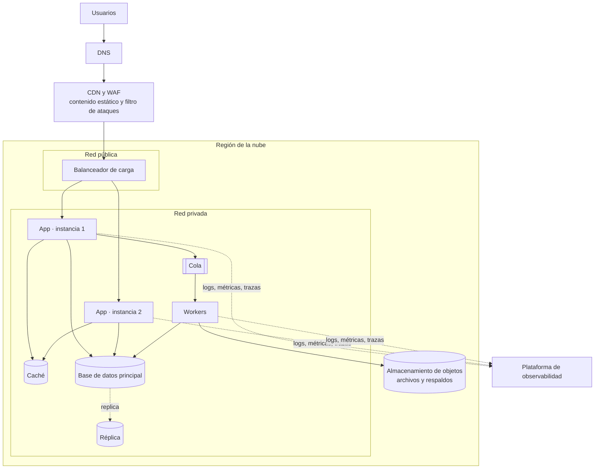
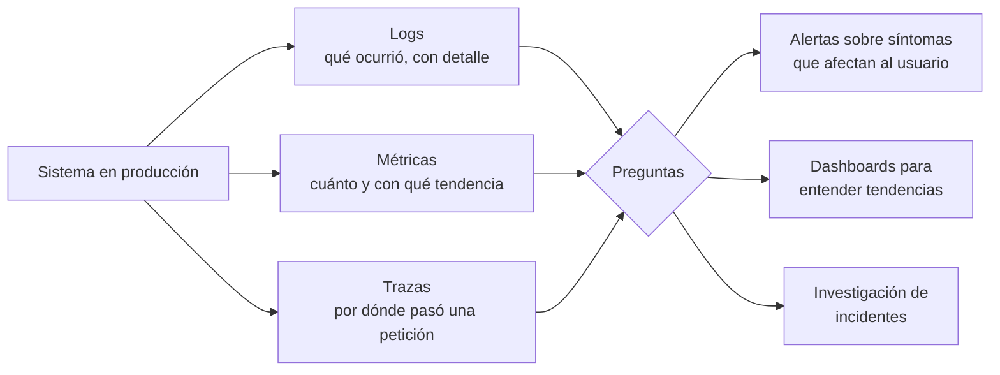

# Nube y observabilidad

## Idea clave

La nube convierte servidores, bases de datos y redes en **servicios que se alquilan y se configuran con código**. Eso da velocidad y elasticidad, pero también crea una factura variable y muchas piezas que pueden fallar. La **observabilidad** es la capacidad de entender qué está pasando dentro del sistema a partir de lo que emite (logs, métricas y trazas), sobre todo cuando ocurre algo que nadie anticipó. Sin ella, cada incidente se investiga a ciegas.

## Diagramas

### Arquitectura típica de un SaaS en la nube

### Los pilares de la observabilidad

## Lo que debes entender

### Modelos de servicio en la nube

| Modelo | Tú gestionas | El proveedor gestiona | Ejemplos |
|---|---|---|---|
| IaaS | Sistema operativo, aplicación, datos | Hardware, red, virtualización | Máquinas virtuales (EC2, Compute Engine, Azure VMs) |
| PaaS | Aplicación y datos | Servidores, sistema operativo, escalado | Heroku, App Engine, Azure App Service |
| Contenedores gestionados | Imágenes y configuración | Orquestación base | Kubernetes gestionado (EKS, GKE, AKS), Cloud Run |
| Serverless (FaaS) | Funciones y su lógica | Todo lo demás, incluido escalar a cero | AWS Lambda, Azure Functions, Cloud Functions |
| Servicios gestionados | Configuración y uso | Operación del servicio | Bases de datos gestionadas, colas, almacenamiento |

### Conceptos que vas a oír

- **Región y zona de disponibilidad**: una región es una ubicación geográfica; dentro de ella hay zonas (centros de datos independientes). Repartir instancias en varias zonas protege ante la caída de una.
- **Escalado horizontal y vertical**: más instancias (horizontal) o instancias más grandes (vertical).
- **Contenedores y Kubernetes**: un contenedor empaqueta la aplicación con sus dependencias; Kubernetes orquesta muchos contenedores. Potente, pero con una curva de aprendizaje y operación considerable.
- **Infraestructura como código (IaC)**: describir la infraestructura en archivos versionados (Terraform, OpenTofu, Pulumi, CloudFormation) en lugar de configurarla a mano en una consola.
- **Modelo de responsabilidad compartida**: el proveedor asegura la nube; tú aseguras lo que pones en ella (configuración, accesos, datos).
- **FinOps**: práctica de gestionar el costo de la nube como responsabilidad compartida entre tecnología, finanzas y producto.

### Observabilidad en la práctica

| Señal | Útil para | Ejemplo |
|---|---|---|
| Logs | Detalle de un evento concreto | "Pago 881 rechazado: tarjeta vencida, tenant 42" |
| Métricas | Tendencias y alertas | Latencia p95, tasa de errores, profundidad de la cola |
| Trazas | Seguir una petición entre servicios | La petición tardó 3 s: 2,7 s en la llamada al proveedor de correo |

- **Percentiles (p50, p95, p99)**: el promedio esconde a los usuarios que sufren. Un p95 de 800 ms significa que el 95 % de las peticiones tarda 800 ms o menos y el 5 % restante tarda más.
- **Señales doradas**: latencia, tráfico, errores y saturación; un buen punto de partida para cualquier servicio.
- **Alertar sobre síntomas, no sobre causas**: "los clientes no pueden pagar" es una buena alerta; "la CPU llegó a 80 %" a menudo no lo es por sí sola.
- **OpenTelemetry**: estándar abierto para instrumentar aplicaciones y enviar señales a distintas herramientas sin quedar atado a una.
- **Datos sensibles en logs**: contraseñas, tokens o datos personales no deben aparecer en los logs.

## Preguntas para tu equipo

1. Si un cliente dice "está lento", ¿cuánto tardamos en saber dónde y por qué?
2. ¿Nuestras alertas nos despiertan por cosas que importan al cliente o por ruido?
3. ¿Qué parte de la infraestructura se creó a mano y nadie sabría reconstruir?
4. ¿Cuánto cuesta nuestra nube al mes y qué tenant o funcionalidad consume más?
5. ¿Qué pasa si se cae una zona de disponibilidad completa?

## Errores comunes

- **Monitorear solo infraestructura** (CPU, memoria) y no la experiencia del cliente.
- **Fatiga de alertas**: tantas alertas irrelevantes que las importantes se ignoran.
- **Configurar a mano en la consola** y no poder reproducir un entorno.
- **Descubrir el costo de la nube cuando llega la factura**, sin presupuesto ni alertas de gasto.
- **Agregar observabilidad después del incidente** en lugar de incluirla en la historia original.

> **Tu rol como Scrum Master**
>
> Propón que "¿cómo sabremos en producción que esto funciona?" sea una pregunta habitual del refinamiento. Si la respuesta incluye métricas o alertas nuevas, son parte de la historia y se estiman con ella, no una tarea para "después".
