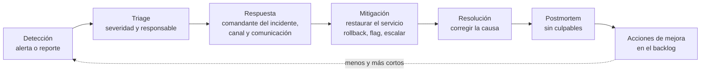
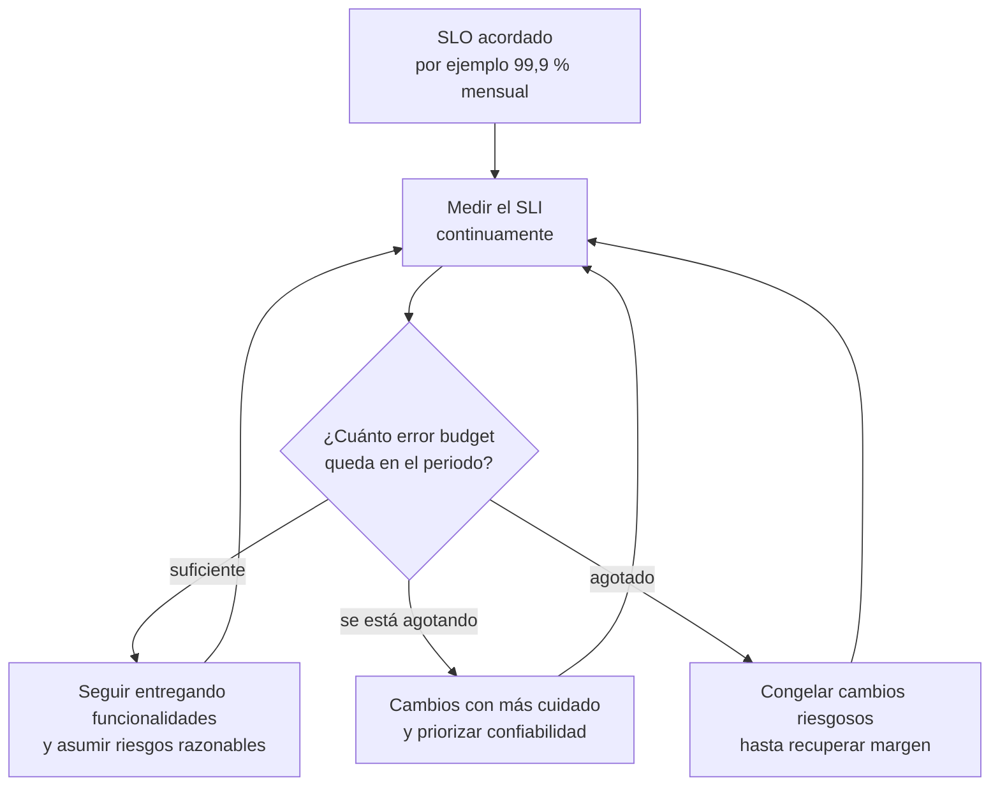

# Confiabilidad e incidentes

## Idea clave

Ningún sistema está disponible el 100 % del tiempo, y perseguir ese número sale carísimo. La práctica de SRE (*Site Reliability Engineering*) propone algo más útil: **acordar cuánta falla es aceptable** para los usuarios (el SLO), medirla (el SLI) y usar el margen restante (el *error budget*) como una herramienta de decisión compartida entre producto y tecnología. Cuando algo falla de todas formas, un proceso de incidentes claro y un postmortem sin culpables convierten el problema en aprendizaje.

## Diagramas

### Ciclo de vida de un incidente

### El error budget como decisión

## Lo que debes entender

### SLI, SLO y SLA

| Término | Qué es | Ejemplo | Quién lo define |
|---|---|---|---|
| SLI (indicador) | Una medición del servicio desde la perspectiva del usuario | Porcentaje de peticiones de pago que responden con éxito en menos de 1 s | Equipo técnico con producto |
| SLO (objetivo) | La meta interna para ese indicador en un periodo | 99,9 % de las peticiones de pago, medido en 30 días | Producto y tecnología, juntos |
| SLA (acuerdo) | Compromiso contractual con el cliente, con consecuencias si se incumple | 99,5 % mensual; si no se cumple, se otorgan créditos | Negocio y legal |

El SLO interno suele ser **más exigente** que el SLA: así el equipo reacciona antes de incumplir el contrato.

### Cuánto tiempo de caída permite cada nivel

Cálculo: tiempo del periodo × (1 − disponibilidad). Se asume un año de 365 días y un mes de 30 días.

| Disponibilidad | Por año | Por mes (30 días) | Por semana | Por día |
|---|---|---|---|---|
| 99 % | 3 d 15 h 36 min | 7 h 12 min | 1 h 40 min 48 s | 14 min 24 s |
| 99,9 % | 8 h 45 min 36 s | 43 min 12 s | 10 min 4,8 s | 1 min 26,4 s |
| 99,95 % | 4 h 22 min 48 s | 21 min 36 s | 5 min 2,4 s | 43,2 s |
| 99,99 % | 52 min 33,6 s | 4 min 19,2 s | 1 min 0,5 s | 8,6 s |

Cada "nueve" adicional reduce el margen a una décima parte. Pasar de 99,9 % a 99,99 % no es "un poco más de esfuerzo": suele exigir redundancia, automatización y guardias de otro nivel. Y la disponibilidad de tu producto no puede superar la de las dependencias críticas que no tienen alternativa.

### Error budget en números

Si el SLO es 99,9 % de peticiones exitosas en 30 días y el servicio recibe 10 millones de peticiones en ese periodo, el error budget es el 0,1 %: **10.000 peticiones fallidas**. Si un despliegue defectuoso consume 6.000 en una tarde, queda el 40 % del presupuesto para el resto del mes. Esa cifra, visible para todos, convierte la discusión "¿features o estabilidad?" en una decisión basada en datos.

### Gestión de incidentes

- **Severidades**: una escala compartida (por ejemplo, SEV1 a SEV4) según impacto en clientes, no según cuán interesante es el problema técnico.
- **Roles**: comandante del incidente (coordina, no necesariamente arregla), responsables técnicos, responsable de comunicación.
- **Comunicación**: actualizaciones periódicas a interesados internos y una página de estado para clientes.
- **Mitigar antes de entender**: primero restaurar el servicio (rollback, apagar un flag); después investigar la causa a fondo.
- **MTTR y MTTD**: tiempo medio hasta recuperar y hasta detectar. Útiles como tendencia, engañosos como meta individual.

### Postmortems sin culpables

Un postmortem documenta qué pasó, el impacto, la línea de tiempo, los factores que contribuyeron y las acciones de mejora. "Sin culpables" (*blameless*) no significa sin responsabilidad: significa asumir que las personas actuaron razonablemente con la información que tenían y buscar qué del sistema (procesos, herramientas, alertas) permitió el error. Cuando se busca culpables, la gente deja de reportar y se pierde información valiosa.

## Preguntas para tu equipo

1. ¿Cuáles son los dos o tres flujos que más le importan al cliente? ¿Tienen SLO?
2. ¿Cuánto error budget consumimos el mes pasado y qué lo consumió?
3. Si mañana ocurre un incidente grave, ¿quién coordina, quién comunica y dónde?
4. ¿Las acciones de los últimos postmortems están en el backlog? ¿Cuántas se completaron?
5. ¿Nuestros SLA contractuales son coherentes con lo que realmente logramos?

## Errores comunes

- **Prometer 99,99 % en un contrato** sin la arquitectura ni el equipo para sostenerlo.
- **Medir disponibilidad como "el servidor responde"** en lugar de "el usuario puede completar su tarea".
- **Postmortems que buscan culpables** o que nunca generan acciones concretas.
- **Acciones de mejora que se quedan fuera del backlog** y compiten en desventaja con las funcionalidades.
- **Héroes de guardia**: siempre la misma persona resuelve todo, sin documentación ni rotación.

> **Tu rol como Scrum Master**
>
> El error budget es una de las herramientas más poderosas que tienes para facilitar la conversación entre el Product Owner y el equipo: transforma "el equipo quiere más tiempo para estabilidad" en "consumimos el 80 % del margen acordado; ¿qué hacemos?". Asegúrate también de que las acciones de los postmortems entren al backlog con prioridad visible y de que la retro revise si se completaron.
