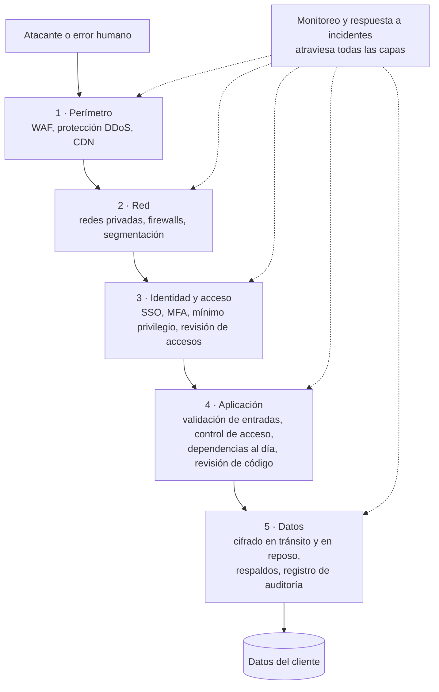

# Seguridad y cumplimiento

## Idea clave

La seguridad no es una funcionalidad que se agrega al final, sino una propiedad que se construye en cada historia. Y en un SaaS tiene una consecuencia comercial directa: los clientes empresariales envían cuestionarios de seguridad, piden certificaciones (SOC 2, ISO 27001) y exigen cláusulas de protección de datos antes de firmar. El **cumplimiento** es la forma de demostrar, con evidencia, que la seguridad no depende de la buena voluntad de nadie.

## Diagramas

### Defensa en profundidad

Ninguna capa es perfecta. La idea es que, si una falla, la siguiente todavía protege.

## Lo que debes entender

### OWASP Top 10 (edición 2021)

OWASP es una fundación abierta que publica, entre otros recursos, una lista de las categorías de riesgo más críticas en aplicaciones web. Esta tabla resume la edición 2021; OWASP actualiza la lista periódicamente (existe una edición posterior que reordena categorías e incorpora riesgos de la cadena de suministro de software), así que verifica la versión vigente en [owasp.org/Top10](https://owasp.org/Top10/).

| Código | Categoría | En palabras simples |
|---|---|---|
| A01 | Broken Access Control | Un usuario puede ver o hacer algo que no debería (por ejemplo, datos de otro tenant). |
| A02 | Cryptographic Failures | Datos sensibles sin cifrar o con cifrado débil. |
| A03 | Injection | Datos del usuario interpretados como comandos (SQL injection, XSS). |
| A04 | Insecure Design | Fallas de diseño que ninguna implementación perfecta corrige. |
| A05 | Security Misconfiguration | Configuraciones por defecto, permisos abiertos, mensajes de error que revelan demasiado. |
| A06 | Vulnerable and Outdated Components | Librerías o dependencias con vulnerabilidades conocidas. |
| A07 | Identification and Authentication Failures | Contraseñas débiles, sesiones mal gestionadas, falta de MFA. |
| A08 | Software and Data Integrity Failures | Actualizaciones o pipelines sin verificación de integridad. |
| A09 | Security Logging and Monitoring Failures | No registrar ni detectar ataques a tiempo. |
| A10 | Server-Side Request Forgery (SSRF) | El servidor puede ser engañado para hacer peticiones a destinos internos. |

### Prácticas que vas a oír

- **Modelado de amenazas**: preguntarse, antes de construir, "¿qué podría salir mal y quién podría abusar de esto?".
- **SAST, DAST y SCA**: análisis estático del código, pruebas dinámicas contra la aplicación en ejecución y análisis de dependencias. Suelen integrarse al pipeline de CI.
- **Gestión de secretos**: claves y contraseñas en un gestor de secretos, nunca en el código ni en el repositorio.
- **Pruebas de penetración (*pentest*)**: especialistas intentan vulnerar el sistema de forma autorizada.
- **Gestión de vulnerabilidades**: plazos acordados para corregir según la severidad.
- **SBOM**: inventario de los componentes de software que usa tu producto, cada vez más solicitado por clientes y reguladores.

### SOC 2 e ISO 27001

| Aspecto | SOC 2 | ISO/IEC 27001 |
|---|---|---|
| Qué es | Informe de auditoría basado en los *Trust Services Criteria* del AICPA | Norma internacional para un sistema de gestión de seguridad de la información (SGSI) |
| Resultado | Un informe de un auditor independiente (no es una "certificación") | Un certificado emitido por un organismo de certificación acreditado |
| Alcance | Seguridad (obligatoria) y, opcionalmente, disponibilidad, integridad del procesamiento, confidencialidad y privacidad | El SGSI completo, con controles de referencia en su Anexo A |
| Variantes | Tipo I: diseño de controles en una fecha. Tipo II: funcionamiento de los controles durante un periodo | Certificación con auditorías de seguimiento periódicas y recertificación |
| Más pedido en | Clientes de Estados Unidos | Clientes de Europa, Latinoamérica y a nivel global |

Para el equipo, ambos se traducen en lo mismo: **procesos repetibles con evidencia**. Revisión de código obligatoria, control de cambios, revisión periódica de accesos, gestión de vulnerabilidades, respaldos probados, respuesta a incidentes documentada.

### Datos personales

- **Principios comunes** en la mayoría de las leyes: finalidad, minimización (pedir solo lo necesario), transparencia, seguridad, plazos de conservación y derechos de los titulares (acceso, rectificación, eliminación, entre otros).
- **Marcos que suelen aparecer**: el RGPD (GDPR) en la Unión Europea; la LGPD en Brasil; en Chile, la Ley 19.628 y la Ley 21.719, que la moderniza y crea una agencia de protección de datos. Las fechas de entrada en vigencia y las obligaciones concretas deben verificarse con asesoría legal.
- **Roles**: en un SaaS B2B, normalmente tu cliente es el **responsable** de los datos y tu empresa el **encargado** que los procesa por su cuenta. Eso se formaliza en un acuerdo de procesamiento de datos (DPA).
- **Implicancias técnicas**: poder exportar y borrar los datos de una persona o de un tenant, saber en qué país se almacenan, registrar quién accede y no copiar datos reales a entornos de prueba sin anonimizar.

## Preguntas para tu equipo

1. ¿Esta historia introduce datos personales nuevos o una nueva forma de acceder a ellos?
2. ¿Cómo nos enteramos de una vulnerabilidad en una de nuestras dependencias? ¿Cuánto tardamos en corregirla?
3. ¿Dónde están los secretos (claves, contraseñas) de este servicio?
4. ¿Podríamos mostrar evidencia de que todo cambio en producción fue revisado?
5. ¿Usamos datos reales de clientes en entornos de desarrollo o pruebas?

## Errores comunes

- **Tratar la seguridad como una fase final** o como responsabilidad exclusiva de "los de seguridad".
- **Secretos en el repositorio**, incluso en repositorios privados.
- **Dependencias sin actualizar durante meses** porque "no hay tiempo".
- **Abordar SOC 2 o ISO 27001 como un proyecto de documentos** en lugar de como hábitos del equipo.
- **Copiar la base de producción a desarrollo** con datos personales reales.

> **Tu rol como Scrum Master**
>
> Las certificaciones exigen que los procesos se cumplan siempre, no solo cuando hay auditoría. Puedes ayudar mucho haciendo que los controles formen parte natural del flujo (Definición de Hecho, plantillas de PR, checklist de refinamiento) y reservando capacidad recurrente para actualizar dependencias y corregir vulnerabilidades, en lugar de tratarlas como interrupciones.
