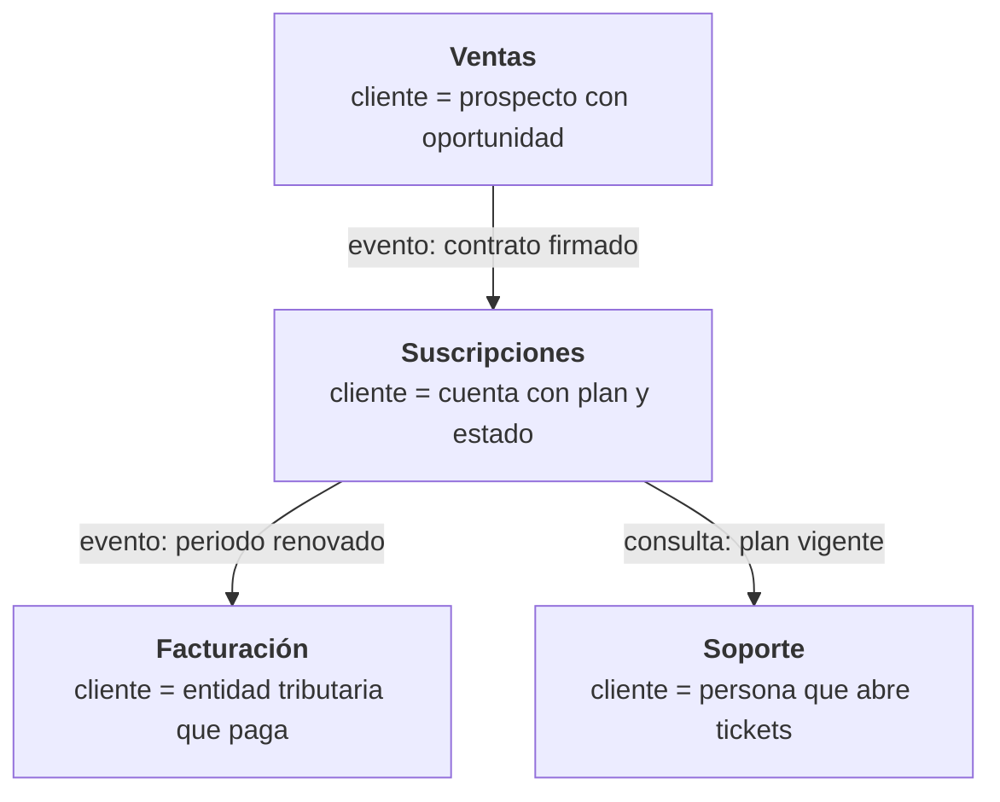
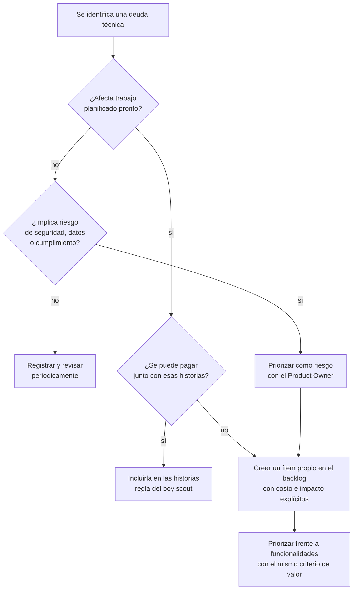
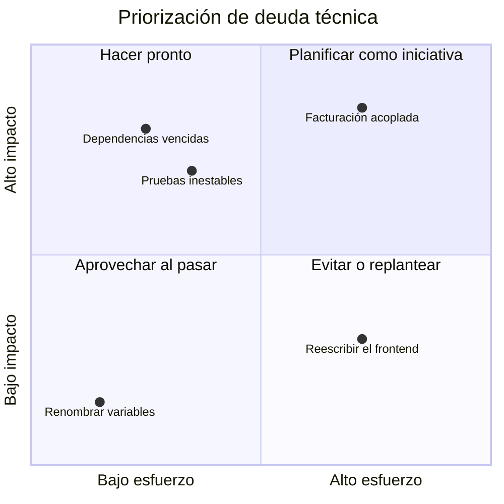

# Diseño de software y deuda técnica

## Idea clave

El diseño de software decide **qué tan caro será el próximo cambio**. Un buen diseño hace que las funcionalidades nuevas cuesten más o menos lo mismo con el tiempo; un diseño deteriorado hace que cada historia cueste un poco más que la anterior. La **deuda técnica** es la metáfora para esa diferencia: atajos (deliberados o no) que aceleran hoy y cobran intereses mañana. Tu trabajo no es eliminarla, sino ayudar a que se gestione de forma visible y con criterios de negocio.

## Diagramas

### Contextos delimitados (DDD conceptual)



La misma palabra, "cliente", significa cosas distintas en cada área. DDD propone aceptar esa diferencia y separar el modelo de cada contexto, en lugar de forzar un único "Cliente" gigante que nadie entiende del todo.

### Decidir qué hacer con una deuda técnica



### Impacto frente a esfuerzo



Los ítems del gráfico son ejemplos para ilustrar la herramienta; ubica los de tu equipo en una sesión conjunta.

## Lo que debes entender

### Principios de diseño en una frase

| Principio | Idea | Señal de que se viola |
|---|---|---|
| S · Responsabilidad única | Cada módulo tiene una sola razón para cambiar | "Para cambiar el correo de bienvenida tuvimos que tocar facturación" |
| O · Abierto/cerrado | Extender comportamiento sin modificar lo que funciona | Cada nuevo tipo de plan exige editar diez `if` |
| L · Sustitución de Liskov | Una variante debe poder usarse donde se espera la general | Una subclase que lanza error en métodos heredados |
| I · Segregación de interfaces | Interfaces pequeñas y específicas | Clases obligadas a implementar métodos que no usan |
| D · Inversión de dependencias | Depender de abstracciones, no de detalles concretos | Imposible probar sin conectarse a la base de datos real |
| Acoplamiento bajo | Las piezas dependen poco unas de otras | Un cambio pequeño rompe cosas lejanas |
| Cohesión alta | Lo que cambia junto está junto | La lógica de un concepto está repartida en muchos lugares |

### DDD sin tecnicismos

*Domain-Driven Design* es un enfoque que pone el conocimiento del negocio en el centro del diseño. Tres ideas bastan para empezar:

- **Lenguaje ubicuo**: el equipo y el negocio usan las mismas palabras con el mismo significado, también en el código.
- **Contextos delimitados**: fronteras dentro de las cuales un modelo es coherente. Son una buena guía para dividir módulos, servicios y hasta equipos.
- **Eventos de dominio**: hechos relevantes para el negocio ("suscripción renovada") que conectan contextos sin acoplarlos.

### ADR: registrar decisiones de arquitectura

Un ADR (*Architecture Decision Record*) es un documento breve que registra una decisión importante: contexto, opciones consideradas, decisión y consecuencias. Se guarda junto al código y no se edita: si la decisión cambia, se escribe un ADR nuevo que reemplaza al anterior. Evita repetir discusiones y explica a quien llega después **por qué** el sistema es como es.

```text
ADR-007: Usar una cola para el envío de correos
Estado: Aceptado
Contexto: el envío síncrono hace que el registro tarde varios segundos y falle si el proveedor de correo cae.
Decisión: publicar los correos en una cola y procesarlos con workers.
Consecuencias: registro más rápido; los correos pueden tardar unos segundos; hay que vigilar la DLQ.
```

### Tipos de deuda técnica

Martin Fowler propuso clasificarla en dos ejes: **deliberada o inadvertida** y **prudente o imprudente**.

| | Imprudente | Prudente |
|---|---|---|
| Deliberada | "No hay tiempo para diseñar" | "Lanzamos ahora y asumimos las consecuencias; lo registramos" |
| Inadvertida | "¿Qué es una arquitectura en capas?" | "Ahora sabemos cómo deberíamos haberlo hecho" |

La deuda prudente y deliberada es una herramienta legítima de negocio, siempre que se registre y se pague. La inadvertida y prudente es inevitable: aprender sobre el problema revela mejores diseños.

### Cómo hacer visible la deuda

- **Registrarla en el backlog** con el mismo formato que una historia: qué duele, a quién, cuánto cuesta no hacerlo.
- **Expresarla en impacto de negocio**: "cada cambio en facturación tarda el triple", "dos incidentes este trimestre", "no podemos ofrecer planes anuales".
- **Medir señales**: *lead time* por área del código, incidentes por componente, archivos que más cambian y más errores generan.
- **Reservar capacidad**: muchos equipos acuerdan con el Product Owner un porcentaje del sprint para mejoras técnicas; el número exacto es una decisión del equipo y del negocio, no una regla universal.

## Preguntas para tu equipo

1. ¿Qué parte del código hace que las historias tarden más de lo que deberían?
2. Si pudiéramos arreglar una sola deuda técnica este trimestre, ¿cuál sería y qué ganaríamos?
3. ¿Qué decisiones de arquitectura importantes no están escritas en ningún lado?
4. ¿Estamos tomando un atajo en esta historia? ¿Lo estamos registrando?
5. ¿Qué palabras del negocio usamos con significados distintos entre equipos?

## Errores comunes

- **Llamar "deuda técnica" a todo lo que no gusta**, lo que diluye el concepto y la credibilidad del equipo.
- **Pedir "un sprint de deuda técnica"** sin objetivo medible, lo que el negocio percibe como una pausa sin valor.
- **Acumular deuda sin registrarla** hasta que la única propuesta es reescribir todo.
- **Discutir la deuda en lenguaje técnico** con personas que deciden en lenguaje de negocio.
- **Diseñar en exceso por adelantado** para escenarios que quizá nunca lleguen: también es una forma de deuda.

> **Tu rol como Scrum Master**
>
> Tu aporte más valioso aquí es la **traducción**. Ayuda al equipo a expresar cada deuda importante como riesgo o costo de negocio, y al Product Owner a compararla con las funcionalidades usando el mismo criterio de valor. Un backlog donde la deuda compite en igualdad de condiciones, con información honesta, es mejor que cualquier porcentaje fijo impuesto desde fuera.
