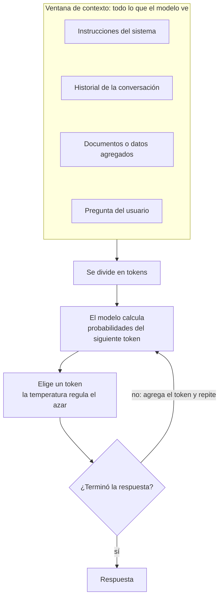
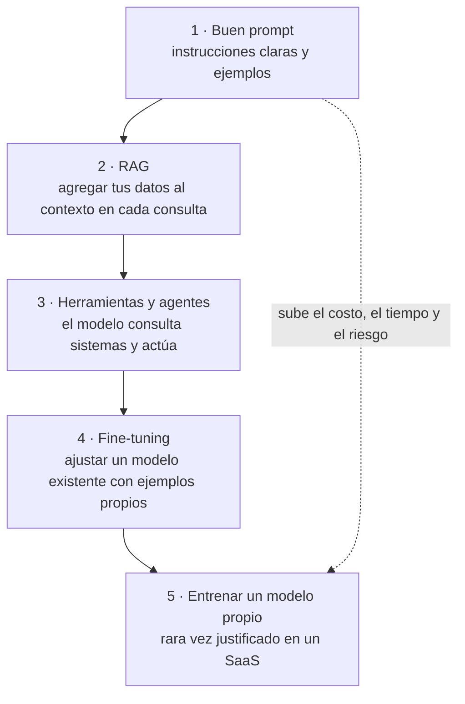
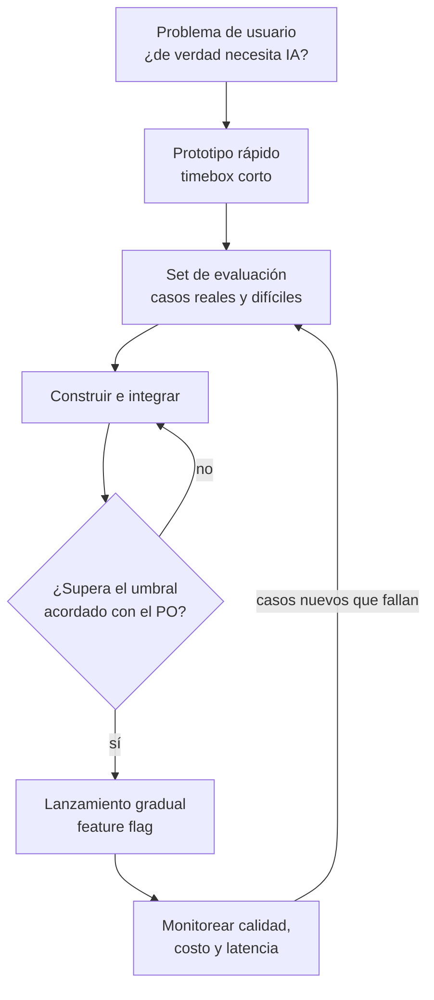

# IA generativa: LLM y fundamentos

## Idea clave

Un LLM (*Large Language Model*, modelo de lenguaje grande) es un modelo entrenado con enormes cantidades de texto para hacer una sola cosa: **predecir cuál es el siguiente fragmento de texto más probable**. Repetida miles de veces, esa capacidad produce respuestas, resúmenes, código y planes que parecen razonados. Pero un LLM no es una base de datos ni un motor de reglas: es probabilístico, puede equivocarse con total seguridad y su calidad se **mide**, no se da por hecha. Para un Scrum Master, eso cambia cómo se estima, cómo se define "hecho" y cómo se conversa sobre riesgos.

## Diagramas

### Cómo responde un LLM

El modelo no "consulta" nada por su cuenta: solo ve lo que está en su ventana de contexto y lo que aprendió durante el entrenamiento.

### Escalera de técnicas: de lo más barato a lo más costoso

La regla práctica: empezar por el peldaño más bajo que resuelva el problema y subir solo cuando las evaluaciones muestren que hace falta.

### Ciclo de vida de una funcionalidad con IA

## Lo que debes entender

### Vocabulario esencial

| Concepto | Qué es | Por qué te importa |
|---|---|---|
| Token | Fragmento de texto (una palabra o parte de ella) con que trabaja el modelo | Los costos, los límites y la velocidad se miden en tokens |
| Ventana de contexto | Cantidad máxima de tokens que el modelo puede considerar a la vez | Limita cuántos documentos o cuánta conversación cabe en una consulta |
| Prompt | La entrada que recibe el modelo; el *system prompt* fija su rol y reglas | Cambiar el prompt cambia el comportamiento: debe versionarse y probarse como código |
| Temperatura | Parámetro que regula cuánto azar hay al elegir cada token | Más baja: respuestas más consistentes. Más alta: más variadas |
| Alucinación | Respuesta plausible pero falsa o inventada | Es un riesgo de producto que se mitiga, no un error que se corrige una vez |
| Fecha de corte | Hasta cuándo llega la información con que se entrenó el modelo | El modelo no sabe lo que pasó después, salvo que se lo des en el contexto |
| Embedding | Representación numérica del significado de un texto | Permite buscar por significado y no solo por palabras exactas (base de RAG) |
| Multimodal | Modelo que entiende o genera texto, imágenes, audio u otros formatos | Abre funcionalidades como leer documentos escaneados o capturas de pantalla |
| Modelo de razonamiento | Modelo que dedica más cómputo a "pensar" antes de responder | Mejor en problemas complejos, a cambio de más latencia y costo |
| Inferencia | Usar el modelo para generar una respuesta | Es lo que se paga en cada llamada, a diferencia del entrenamiento |

### Modelos vía API o modelos abiertos

| Aspecto | Modelo de un proveedor vía API | Modelo abierto (*open-weight*) operado por el equipo |
|---|---|---|
| Puesta en marcha | Rápida: una cuenta y una clave | Lenta: infraestructura con GPU, despliegue y escalado |
| Calidad | Suele incluir los modelos más capaces | Variable; muy buena para tareas acotadas |
| Costo | Variable, por token consumido | Fijo de infraestructura más operación |
| Datos | Viajan al proveedor: revisar contrato, retención y región | Quedan en tu infraestructura |
| Dependencia | Cambios de versión, precios o disponibilidad del proveedor | Mantenimiento y actualizaciones a cargo del equipo |

### El costo es una variable de producto

En una funcionalidad con IA, cada uso tiene un costo directo. Una estimación simple:

**costo mensual ≈ llamadas al mes × (tokens de entrada × precio de entrada + tokens de salida × precio de salida)**

**Ejemplo con precios hipotéticos** (usa los de tu proveedor): 100.000 llamadas al mes, 2.000 tokens de entrada y 500 de salida por llamada, a 3 USD por millón de tokens de entrada y 15 USD por millón de salida.

- Entrada: 100.000 × 2.000 = 200 millones de tokens → 200 × 3 = **600 USD**
- Salida: 100.000 × 500 = 50 millones de tokens → 50 × 15 = **750 USD**
- Total: **1.350 USD al mes**

Si el plan del cliente cuesta poco y usa mucho la funcionalidad, el margen puede desaparecer. Por eso calidad, costo y latencia forman un triángulo que el Product Owner debe equilibrar con información, no por intuición.

### Lo que cambia en el trabajo ágil

- **Estimación**: hay más incertidumbre sobre si algo "funcionará bien". Conviene separar un *spike* con timebox para el prototipo y el set de evaluación antes de comprometer la construcción.
- **Criterios de aceptación**: pasan de "hace X" a umbrales medibles, por ejemplo "responde correctamente al menos el 90 % de los casos del set de evaluación y nunca inventa un precio". El umbral es una decisión de producto.
- **Pruebas**: la misma entrada puede producir salidas distintas. Las pruebas tradicionales se complementan con **evaluaciones** (*evals*) que miden calidad sobre muchos casos (más en el [módulo 14](14-ia-rag-agentes.md)).
- **Definición de Hecho**: suma evaluaciones aprobadas, monitoreo de calidad y costo en producción, y un plan de qué hacer cuando el modelo falla.
- **Cambios de proveedor o versión de modelo**: son cambios con riesgo, como una migración. Se evalúan antes de aplicarse.

## Preguntas para tu equipo

1. ¿Qué problema del usuario resuelve esta funcionalidad y por qué necesita IA en lugar de reglas simples?
2. ¿Cómo sabremos si la respuesta es buena? ¿Tenemos casos de prueba reales, incluidos los difíciles?
3. ¿Qué pasa cuando el modelo se equivoca? ¿Cómo lo nota el usuario y cómo lo corrige?
4. ¿Cuánto cuesta cada uso y cómo escala con nuestros clientes más intensivos?
5. ¿Qué datos de clientes enviamos al modelo? ¿El contrato con el proveedor lo permite?
6. ¿Qué haremos si el proveedor cambia o retira el modelo que usamos?

## Errores comunes

- **Empezar por la tecnología** ("pongamos IA") en lugar de por el problema del usuario.
- **Aceptar una demo como prueba de calidad**: diez ejemplos que salen bien no dicen nada de los mil que vendrán.
- **Tratar el prompt como texto suelto** sin versionarlo, revisarlo ni evaluarlo.
- **Ignorar el costo por uso** hasta que llega la factura.
- **Prometer exactitud del 100 %** a clientes o a la dirección.
- **Pegar datos sensibles en herramientas de IA** sin revisar las políticas de la empresa.

> **Tu rol como Scrum Master**
>
> La IA aumenta la incertidumbre y la presión por "tenerlo ya". Tu aporte es proteger el empirismo: proponer experimentos cortos con hipótesis y criterio de éxito explícitos, hacer que el Product Owner defina qué calidad es "suficiente" antes de construir, y asegurar que costo, riesgos y evaluaciones sean visibles en el backlog. Una funcionalidad de IA sin forma de medirse es una apuesta, no un incremento.
