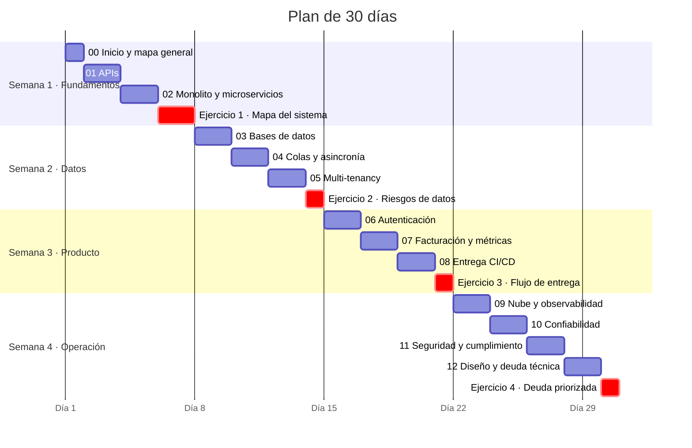

# Plan de 30 días y glosario

## Idea clave

Leer no basta: el aprendizaje se consolida cuando **conversas con tu equipo** sobre lo que estudiaste y lo aplicas a tu propio producto. Este plan reparte los módulos en cuatro semanas, con un ejercicio práctico al final de cada una. Dedícale entre 30 y 45 minutos diarios; si una semana se complica, desplaza el plan en lugar de saltarte los ejercicios.

## Plan de estudio

Las fechas del diagrama son solo de referencia: el eje muestra los días 1 a 30 del plan. Empieza el día que quieras.

## Lo que debes entender

### Ejercicios prácticos

**Ejercicio 1 · Mapa del sistema (días 6 y 7).** Pide a una persona del equipo 30 minutos para dibujar juntos la arquitectura de tu producto con cajas y flechas. Identifica: dónde entra una petición, dónde se guardan los datos, qué terceros intervienen y qué parte "da miedo tocar". Compara el resultado con el [mapa general](00-inicio.md).

**Ejercicio 2 · Riesgos de datos (día 14).** Toma tres historias recientes del backlog y responde para cada una: ¿toca datos existentes?, ¿podría exponer datos de otro tenant?, ¿introduce datos personales? Lleva lo que encuentres al siguiente refinamiento.

**Ejercicio 3 · Flujo de entrega (día 21).** Elige una historia ya terminada y reconstruye su camino: cuándo se creó la rama, cuándo se abrió el PR, cuánto esperó revisión, cuándo llegó a producción. Calcula el *lead time* y dónde estuvo la mayor espera. Compártelo en la retro como dato, no como juicio.

**Ejercicio 4 · Deuda priorizada (día 30).** Facilita una sesión de 45 minutos con el equipo: listen las deudas técnicas que más les duelen, ubíquenlas en la matriz de impacto y esfuerzo del [módulo 12](12-diseno-deuda-tecnica.md) y redacten las dos más importantes en lenguaje de negocio para presentarlas al Product Owner.

### Autoevaluación

Al terminar el plan, deberías poder explicar con tus palabras:

- La diferencia entre un 401 y un 403, y entre un 4xx y un 5xx.
- Por qué un mensaje de una cola puede procesarse dos veces y qué hace el equipo para que no importe.
- Qué modelo de multi-tenancy usa tu producto y cuál es su principal riesgo.
- La diferencia entre autenticación y autorización, y qué aporta el SSO a un cliente empresarial.
- Qué es el MRR y por qué un NRR sobre 100 % es una buena señal.
- Las cuatro métricas DORA clásicas y cuál es la más débil en tu equipo.
- Qué SLO tiene (o debería tener) el flujo más importante de tu producto, y cuánto tiempo de caída mensual permite.
- Qué es un ADR y una deuda técnica prudente y deliberada.

## Glosario

| Término | Definición breve | Módulo |
|---|---|---|
| ADR | Registro breve de una decisión de arquitectura con su contexto y consecuencias. | 12 |
| API | Contrato que define cómo un sistema se comunica con otro. | 01 |
| ARR / MRR | Ingreso recurrente anual / mensual. | 07 |
| Backoff exponencial | Esperar cada vez más entre reintentos. | 04 |
| Blue-green | Despliegue con dos entornos idénticos entre los que se cambia el tráfico. | 08 |
| Caché | Copia rápida de datos para evitar recalcularlos o volver a buscarlos. | 03, 09 |
| Canario | Despliegue que expone la versión nueva a una fracción pequeña del tráfico. | 08 |
| CDN | Red de servidores distribuidos que entrega contenido cerca del usuario. | 09 |
| Churn | Pérdida de clientes o de ingresos en un periodo. | 07 |
| CI/CD | Integración continua y entrega o despliegue continuo. | 08 |
| Contexto delimitado | Frontera dentro de la cual un modelo de dominio es coherente (DDD). | 12 |
| Cobertura de código | Porcentaje del código ejecutado por las pruebas. | 08 |
| DLQ | Cola donde terminan los mensajes que no se pudieron procesar. | 04 |
| DORA | Programa de investigación y sus métricas de desempeño de entrega de software. | 08 |
| DPA | Acuerdo de procesamiento de datos entre responsable y encargado. | 11 |
| Dunning | Proceso de reintentar cobros fallidos y avisar al cliente. | 07 |
| E2E | Prueba de punta a punta que simula a un usuario real. | 08 |
| Entitlements | Funcionalidades y límites que corresponden a cada plan. | 07 |
| Error budget | Margen de falla permitido por un SLO en un periodo. | 10 |
| Feature flag | Interruptor que enciende o apaga una funcionalidad sin desplegar. | 08 |
| Idempotencia | Propiedad de una operación que produce el mismo resultado si se repite. | 01, 04 |
| IaC | Infraestructura como código: infraestructura descrita en archivos versionados. | 09 |
| IdP | Proveedor de identidad que gestiona las cuentas de una organización. | 06 |
| Índice | Estructura que acelera búsquedas en una base de datos. | 03 |
| JWT | Formato de token firmado que transporta datos del usuario. | 06 |
| Latencia p95 | Tiempo bajo el cual responde el 95 % de las peticiones. | 09 |
| Lead time de cambios | Tiempo desde el commit hasta producción. | 08 |
| MFA | Autenticación con más de un factor. | 06 |
| Microservicios | Arquitectura de servicios pequeños desplegados por separado. | 02 |
| Migración de esquema | Cambio versionado de la estructura de la base de datos. | 03 |
| Monolito modular | Una sola aplicación con módulos internos bien delimitados. | 02 |
| MTTR | Tiempo medio hasta restaurar el servicio. | 10 |
| Multi-tenancy | Muchos clientes compartiendo una plataforma con datos aislados. | 05 |
| N+1 | Patrón de consultas ineficiente: una consulta por cada elemento de una lista. | 03 |
| Noisy neighbor | Cliente que, por su uso intensivo, degrada el servicio de otros. | 05 |
| NRR / GRR | Retención neta / bruta de ingresos de los clientes existentes. | 07 |
| OAuth 2.0 | Estándar para delegar acceso sin compartir contraseñas. | 06 |
| Observabilidad | Capacidad de entender el estado interno de un sistema por lo que emite. | 09 |
| OIDC | Capa de identidad sobre OAuth 2.0, base de muchos SSO. | 06 |
| OWASP Top 10 | Lista de categorías de riesgo más críticas en aplicaciones web. | 11 |
| Postmortem | Análisis sin culpables de un incidente, con acciones de mejora. | 10 |
| Pull request | Propuesta de cambio de código que se revisa antes de integrarse. | 08 |
| Rate limiting | Límite de peticiones por cliente en un periodo. | 01 |
| RBAC | Control de acceso basado en roles. | 06 |
| Réplica de lectura | Copia de la base de datos para consultas de solo lectura. | 03 |
| RPO / RTO | Datos que se pueden perder / tiempo sin servicio tolerable ante un desastre. | 03 |
| SAML | Estándar de SSO basado en XML. | 06 |
| SCIM | Estándar para aprovisionar y desaprovisionar usuarios automáticamente. | 06 |
| SLI / SLO / SLA | Indicador, objetivo y acuerdo contractual de nivel de servicio. | 10 |
| SOC 2 | Informe de auditoría sobre controles basado en criterios del AICPA. | 11 |
| SSO | Inicio de sesión único para varias aplicaciones. | 06 |
| Strangler fig | Migración gradual que reemplaza un sistema antiguo pieza por pieza. | 02 |
| Tenant | Cliente (organización) dentro de un SaaS multi-tenant. | 05 |
| Traza | Registro del recorrido de una petición entre servicios. | 09 |
| Trunk-based development | Integrar cambios pequeños a la rama principal con mucha frecuencia. | 08 |
| Webhook | Aviso HTTP que un sistema envía a otro cuando ocurre un evento. | 01 |

## Lecturas recomendadas

> **Atención: verifica antes de comprar o citar**
>
> Esta lista se escribió de memoria como punto de partida. Antes de usarla, confirma títulos, autores, ediciones vigentes, disponibilidad en español y que los enlaces sigan activos.

**Libros**

- *Accelerate* — Nicole Forsgren, Jez Humble y Gene Kim. La investigación detrás de las métricas DORA.
- *Site Reliability Engineering* y *The Site Reliability Workbook* — equipo de SRE de Google (editores varios). Base de los conceptos de SLO y error budget; Google ofrece versiones en línea en sre.google.
- *Team Topologies* — Matthew Skelton y Manuel Pais. Relación entre estructura de equipos y arquitectura.
- *Building Microservices* y *Monolith to Microservices* — Sam Newman. Cuándo y cómo separar servicios.
- *Designing Data-Intensive Applications* — Martin Kleppmann. Bases de datos, colas y sistemas distribuidos en profundidad.
- *Domain-Driven Design* — Eric Evans, y *Domain-Driven Design Distilled* — Vaughn Vernon, una introducción más breve.
- *The Phoenix Project* — Gene Kim, Kevin Behr y George Spafford. Novela sobre operaciones de TI y DevOps, útil para contextos no técnicos.

**Recursos en línea**

- [dora.dev](https://dora.dev): investigación y definiciones actuales de las métricas DORA.
- [sre.google](https://sre.google): libros y recursos de SRE.
- [owasp.org/Top10](https://owasp.org/Top10/): edición vigente del OWASP Top 10.
- [martinfowler.com](https://martinfowler.com): artículos sobre deuda técnica, *strangler fig*, feature flags y más.
- [adr.github.io](https://adr.github.io): plantillas y ejemplos de ADR.
- [opentelemetry.io](https://opentelemetry.io): documentación del estándar de observabilidad.

## Preguntas para tu equipo

1. ¿Qué módulo de esta guía creen que más me ayudaría a entender nuestro trabajo?
2. ¿Qué término técnico usamos a diario que no está en este glosario?
3. ¿Quién estaría dispuesto a acompañarme 30 minutos para revisar el mapa de nuestro sistema?

## Errores comunes

- **Estudiar solo, sin conversar con el equipo**: el contexto de tu producto vale más que cualquier definición general.
- **Querer demostrar lo aprendido** corrigiendo decisiones técnicas en lugar de hacer mejores preguntas.
- **Abandonar el plan por una semana difícil**: retómalo donde quedaste.

> **Tu rol como Scrum Master**
>
> Al terminar, comparte con tu equipo qué aprendiste y qué cambiarás en tu forma de facilitar. Mostrar que aprendes en público invita al equipo a hacer lo mismo, y es una buena manera de cerrar el ciclo de este plan.
