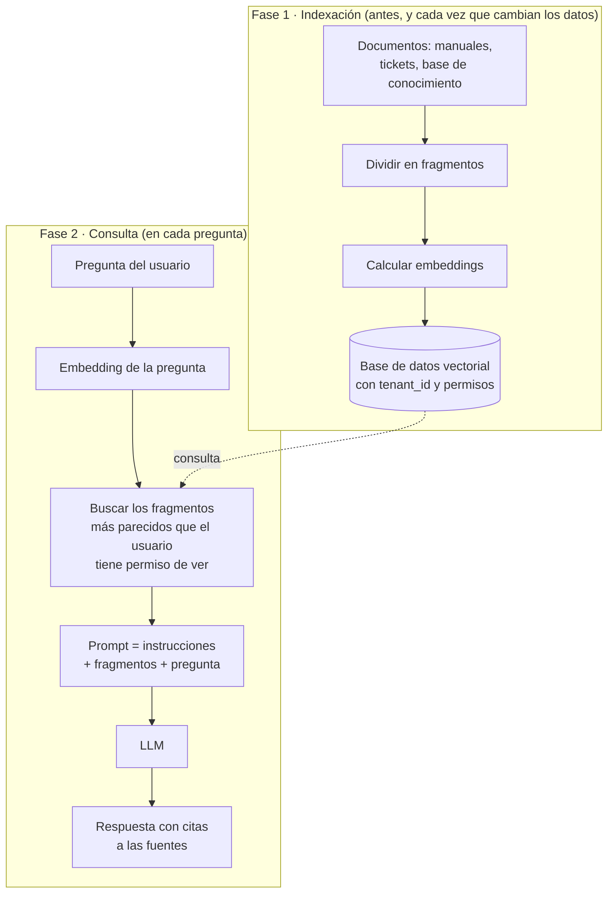
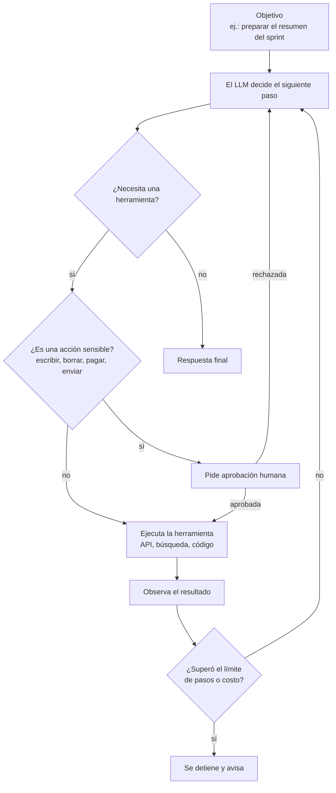
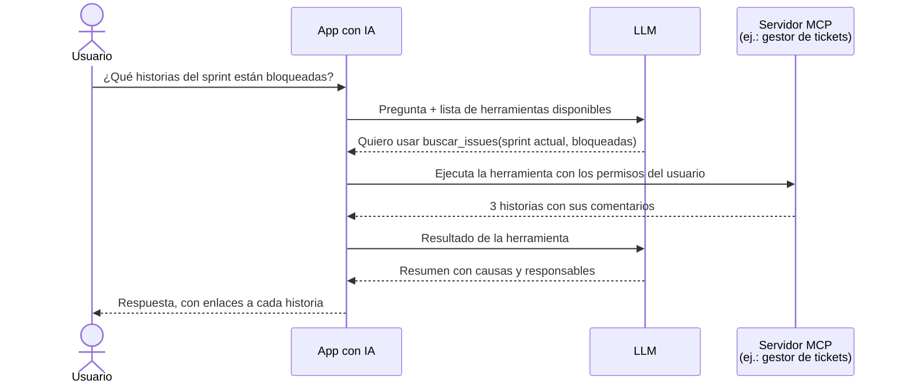
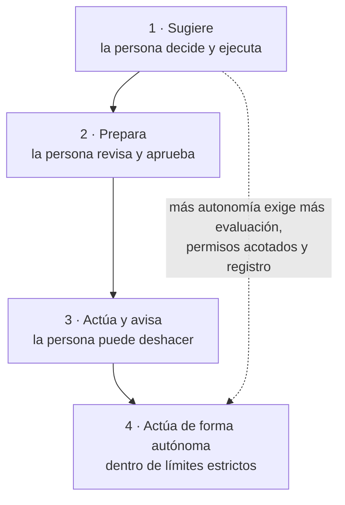
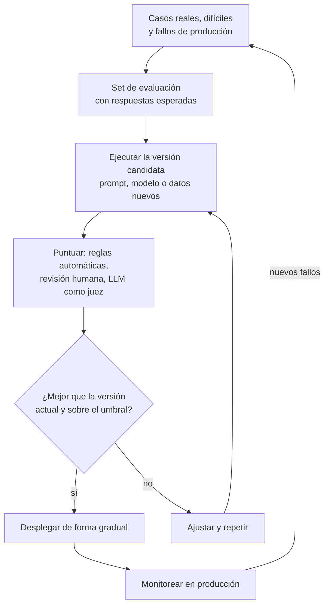

# IA en el producto: RAG, agentes y evaluación

## Idea clave

Un LLM solo sabe lo que aprendió en su entrenamiento y lo que le pones en el contexto. Tres ideas convierten esa limitación en producto: **RAG** le entrega tus datos en cada consulta, los **agentes** le permiten usar herramientas y actuar, y las **evaluaciones** te dicen si todo eso funciona. Cada paso agrega poder y también riesgo: un modelo que solo responde puede equivocarse; un agente que actúa puede equivocarse **haciendo algo**. Para un Scrum Master, la pregunta clave es cuánta autonomía le damos, con qué controles y cómo lo medimos.

## Diagramas

### RAG: generación aumentada con recuperación

### El ciclo de un agente

### Herramientas con MCP

El LLM nunca ejecuta nada directamente: **pide** usar una herramienta y la aplicación decide si lo permite y con qué permisos.

### Niveles de autonomía

### Ciclo de evaluación

## Lo que debes entender

### RAG en piezas

- **Fragmentación (*chunking*)**: los documentos se dividen en trozos. Si son muy grandes, la búsqueda es imprecisa; si son muy chicos, se pierde contexto.
- **Embeddings y base vectorial**: cada fragmento se guarda con un vector que representa su significado. Herramientas comunes: extensiones como pgvector en PostgreSQL o bases dedicadas.
- **Recuperación**: se buscan los fragmentos más parecidos a la pregunta; muchos equipos combinan búsqueda por significado y por palabras clave, y reordenan los resultados (*re-ranking*).
- **Citas**: mostrar de qué documento salió cada afirmación permite al usuario verificar y reduce el impacto de las alucinaciones.
- **Frescura**: si los documentos cambian, el índice debe actualizarse. Un índice desactualizado responde con información vieja.
- **Multi-tenancy**: el índice vectorial **también** necesita filtrar por tenant y por permisos. Un RAG que busca en los documentos de todos los clientes es una fuga de datos con una interfaz amable (ver [módulo 05](05-multi-tenancy.md)).

### RAG, fine-tuning o prompt

| Necesidad | Mejor punto de partida | Por qué |
|---|---|---|
| Responder sobre información propia que cambia | RAG | Los datos se actualizan sin reentrenar y se pueden citar |
| Seguir un formato o tono muy específico | Prompt con ejemplos; luego fine-tuning si no alcanza | El fine-tuning enseña estilo y formato mejor que hechos |
| Conocer datos privados de cada cliente | RAG con filtros por tenant | El fine-tuning mezclaría datos de clientes en el modelo |
| Tareas acotadas a gran volumen y bajo costo | Modelo más pequeño, con fine-tuning si hace falta | Puede igualar calidad en tareas específicas a menor costo |
| Ejecutar acciones en otros sistemas | Herramientas y agentes | El modelo necesita acceso controlado a APIs |

### Agentes y herramientas

- ***Tool use* o *function calling***: el modelo recibe una lista de herramientas (con nombre, descripción y parámetros) y responde indicando cuál quiere usar. La aplicación la ejecuta y le devuelve el resultado.
- **MCP (*Model Context Protocol*)**: estándar abierto, presentado por Anthropic a fines de 2024, para conectar aplicaciones de IA con herramientas y fuentes de datos de forma uniforme. En vez de una integración a medida por cada combinación de app y sistema, cada sistema expone un servidor MCP que distintas apps pueden usar.
- **Flujo de trabajo o agente**: un *workflow* sigue pasos definidos por el equipo, con el LLM en algunos de ellos; un agente decide sus propios pasos. Los flujos son más predecibles y fáciles de probar; los agentes, más flexibles. Una buena práctica es usar la opción más simple que resuelva el problema.
- **Multiagente**: varios agentes especializados que colaboran. Útil en algunos casos, pero multiplica el costo, la latencia y los puntos de falla.
- **Humano en el ciclo (*human-in-the-loop*)**: puntos donde una persona aprueba antes de que el agente actúe. Es la herramienta principal para manejar el riesgo de acciones irreversibles.
- **Límites**: máximo de pasos, de tiempo y de costo por tarea, para que un agente no quede en un ciclo consumiendo recursos.

### Evaluaciones (*evals*)

| Tipo | Cómo funciona | Bueno para |
|---|---|---|
| Reglas automáticas | Verificaciones exactas: formato JSON válido, contiene la cita, no menciona precios | Requisitos objetivos; corren en el pipeline de CI |
| Revisión humana | Personas expertas califican una muestra de respuestas | Calidad sutil; también para calibrar a los jueces automáticos |
| LLM como juez | Otro modelo califica las respuestas según una rúbrica | Escalar la evaluación a muchos casos; requiere validar al juez |
| Pruebas A/B y métricas de producto | Comparar versiones con usuarios reales | Confirmar que la mejora técnica se traduce en valor |

Métricas habituales: exactitud, fidelidad a las fuentes (no afirmar lo que los documentos no dicen), tasa de respuestas "no sé" cuando corresponde, latencia y costo por tarea.

### Riesgos específicos

| Riesgo | Qué es | Mitigaciones habituales |
|---|---|---|
| Inyección de prompt directa | Un usuario escribe instrucciones para que el modelo ignore sus reglas | Separar instrucciones de datos, validar salidas, no confiar en el prompt como control de seguridad |
| Inyección de prompt indirecta | Un documento, correo o web que el modelo lee contiene instrucciones ocultas | Tratar todo contenido externo como no confiable, limitar qué herramientas puede activar |
| Exceso de permisos (*excessive agency*) | El agente tiene más acceso del que necesita | Mínimo privilegio, permisos del usuario que pide, aprobación humana para acciones sensibles |
| Fuga de datos | El modelo revela datos de otro usuario o tenant | Filtrar en la recuperación, no solo en el prompt; pruebas de aislamiento |
| Alucinación con apariencia de autoridad | Respuesta falsa presentada con confianza | Citas, respuestas "no sé", evaluaciones de fidelidad |
| Costo descontrolado | Ciclos de agentes o abusos que disparan el consumo | Límites por tarea y por tenant, alertas de gasto |

OWASP mantiene un Top 10 específico para aplicaciones con LLM; verifica la edición vigente en [genai.owasp.org](https://genai.owasp.org) antes de usarlo como referencia.

### Gobernanza y cumplimiento

- **Datos enviados a proveedores**: qué se envía, si el proveedor lo retiene o lo usa para entrenar, y en qué región se procesa. Debe quedar reflejado en contratos y en lo que se informa a los clientes.
- **Transparencia**: los usuarios deberían saber cuándo interactúan con IA y cuándo un contenido fue generado.
- **Regulación**: marcos como la Ley de IA de la Unión Europea clasifican usos según su nivel de riesgo y exigen obligaciones distintas; las fechas y alcances deben verificarse con asesoría legal.
- **Clientes empresariales**: los cuestionarios de seguridad ya incluyen preguntas sobre IA. Tener respuestas documentadas acelera las ventas.

### La IA dentro del equipo

Los asistentes y agentes de programación ya forman parte del día a día de muchos equipos. Desde la mirada de flujo:

- **Escribir código más rápido no garantiza entregar más rápido**: si se genera más código del que se puede revisar, el cuello de botella se mueve a la revisión y a las pruebas.
- **Mide el sistema, no la herramienta**: *lead time*, tasa de fallo de cambios y retrabajo (ver [módulo 08](08-entrega-ci-cd.md)) dicen más que "líneas generadas" o "porcentaje de código con IA". La investigación de DORA ha estudiado el efecto de la adopción de IA en la entrega de software; revisa sus hallazgos vigentes en [dora.dev](https://dora.dev) antes de citarlos.
- **Cambios pequeños siguen siendo la regla**: un PR enorme generado con IA es tan difícil de revisar como uno escrito a mano.
- **Acuerdos de equipo**: qué herramientas se permiten, qué datos se pueden compartir con ellas y quién es responsable del código que se integra (siempre una persona).

## Preguntas para tu equipo

1. ¿Este caso necesita un agente o basta con un flujo de pasos fijos con IA en alguno?
2. ¿Qué acciones puede ejecutar el agente sin aprobación humana? ¿Cuáles son irreversibles?
3. ¿Con qué permisos actúan las herramientas: los del usuario que pregunta o unos más amplios?
4. ¿Cómo garantizamos que el RAG solo recupera documentos que el usuario puede ver?
5. ¿Qué pasa si un documento que el modelo lee contiene instrucciones maliciosas?
6. ¿Dónde está el set de evaluación, quién lo mantiene y se ejecuta en cada cambio de prompt o modelo?
7. Desde que usamos asistentes de código, ¿cambiaron nuestro *lead time* y nuestra tasa de fallo de cambios?

## Errores comunes

- **Empezar por un agente autónomo** cuando un flujo predecible resolvía el problema.
- **Filtrar permisos en el prompt** ("no muestres datos de otros clientes") en lugar de hacerlo en el código y en la búsqueda.
- **Indexar documentos sin dueño** y descubrir que el asistente responde con políticas obsoletas.
- **No tener set de evaluación**, y decidir cambios de modelo por intuición.
- **Dar a un agente credenciales de administrador** "para que funcione".
- **Medir la adopción de IA en el equipo por volumen de código** en lugar de por resultados de entrega.

> **Tu rol como Scrum Master**
>
> Facilita la conversación sobre autonomía antes de construir: con el Product Owner y el equipo, ubiquen cada acción en los niveles de autonomía y acuerden qué evidencia se necesita para subir de nivel. Haz visibles en el backlog los ítems que no se ven en una demo (set de evaluación, límites de costo, pruebas de aislamiento entre tenants) e incorpora "evals aprobadas" a la Definición de Hecho. Y dentro del equipo, cuida que la IA mejore el flujo completo y no solo la velocidad de escribir código.
